<p align="center">
  
</p>

<p align="center"><strong>Le centre d'appels qui pense, parle et décide.</strong></p>

<p align="center">
  Agents vocaux IA · PBX d'entreprise en marque blanche · NIMBORA Softphone · supervision temps réel · IA souveraine
</p>

<p align="center">
  <a href="LICENSE"></a>
  <a href="https://github.com/optimiumnexusllc/nimbora/actions/workflows/softphone.yml"></a>
  
  
  
  
  
</p>

<p align="center">
  <a href="#ce-qui-rend-nimbora-différent">Fonctionnalités</a> ·
  <a href="#installation-sur-un-vps">Installation</a> ·
  <a href="#architecture">Architecture</a> ·
  <a href="docs/">Documentation</a> ·
  <a href="#feuille-de-route">Feuille de route</a>
</p>

<p align="center">
  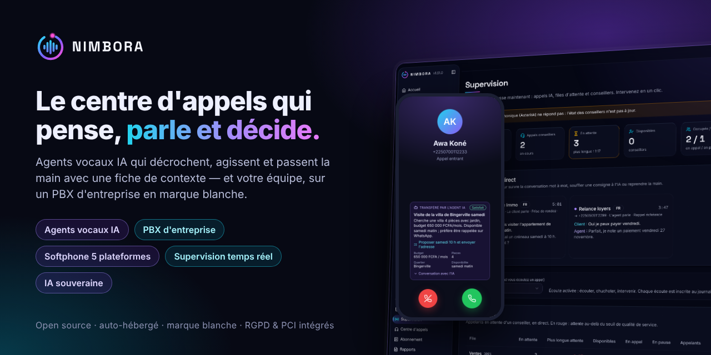
</p>

NIMBORA est une plateforme de centre d'appels **100 % auto-hébergée et en marque blanche** que
vous proposez en abonnement à des entreprises. Chaque entreprise cliente dispose de ses agents vocaux IA, de ses
files d'attente et de ses conseillers humains, sur **votre** serveur et avec **vos** modèles d'IA.
Les agents IA décrochent, comprennent, agissent avec des outils, se souviennent de chaque client,
passent la main à un humain avec un résumé, rappellent les clients perdus, et un superviseur peut
tout suivre et intervenir en direct. Côté humains, un **PBX d'entreprise à votre marque** (postes,
files, serveurs vocaux, lignes opérateurs, enregistrements) et **NIMBORA Softphone** sur
ordinateur, mobile et navigateur complètent la plateforme.

| En un coup d'œil | |
|---|---|
| 🤖 **Agents vocaux IA** | décrochent 24 h/24, agissent (rendez-vous, tickets, SMS), se souviennent de chaque client, parlent la langue de l'appelant |
| 🤝 **Passation avec contexte** | l'IA transfère vers une file ou un poste ; le conseiller voit motif, résumé et humeur dès la sonnerie |
| ☎️ **PBX d'entreprise** | moteur Wazo Platform à votre marque, administré entièrement depuis NIMBORA |
| 📱 **NIMBORA Softphone** | Windows, macOS, Linux, Android, iPhone et navigateur, jumelage par QR code |
| 🎧 **Supervision temps réel** | appels IA et humains sur un écran, écoute / chuchotement / intervention, statistiques de files |
| 🔁 **Aucun client perdu** | appels manqués et transferts abandonnés rappelés automatiquement par un agent IA |
| 🛡️ **Souverain et conforme** | IA auto-hébergée possible, RGPD, masquage PCI, numéros bloqués, journal des écoutes |

---

## Ce qui rend NIMBORA différent

### 🎧 Supervision en direct

Tous les appels en cours sur un seul écran, **en temps réel** (WebSocket) et sur tous les serveurs :
appels IA, files d'attente, conseillers — ceux du centre d'appels intégré **et ceux du PBX
d'entreprise**. Suivez une conversation IA **mot à mot**, **soufflez une consigne** à l'IA sans que le
client l'entende, faites-lui dire une phrase, **reprenez la main** en transférant à un conseiller.
Côté humains : appelants en attente file par file (en rouge au-delà du seuil de qualité de service),
état de chaque conseiller, et **écoute, chuchotement et intervention** dans un appel en un clic —
votre téléphone sonne, vous décrochez. L'écoute s'active entreprise par entreprise, après
confirmation que les salariés sont informés, avec postes protégés et **journal des écoutes**.
Statistiques des files et des conseillers : taux de décroché, niveau de service, attente moyenne,
occupation. **Alertes** quand un client attend trop ou qu'une file n'a plus de conseiller : bandeau et
notification du navigateur, **webhook** (Slack, Teams, Google Chat, n8n) et **e-mail**, au début et à la
fin de chaque alerte. Et un **mur d'affichage** plein écran pour l'écran du plateau.

<p align="center">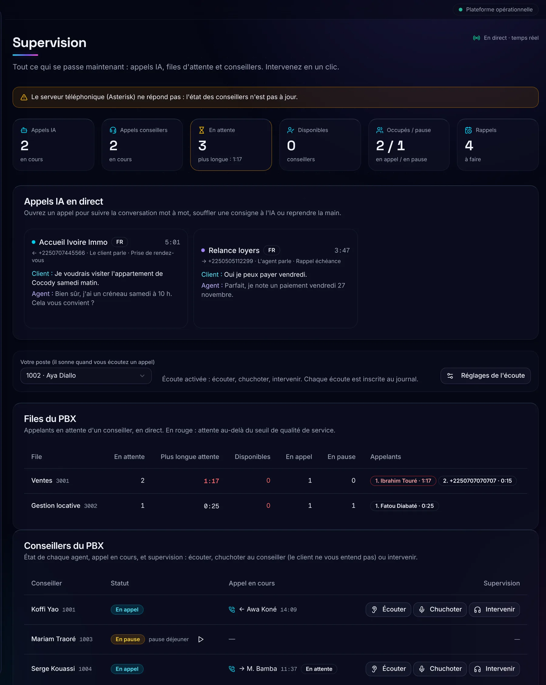</p>
<p align="center">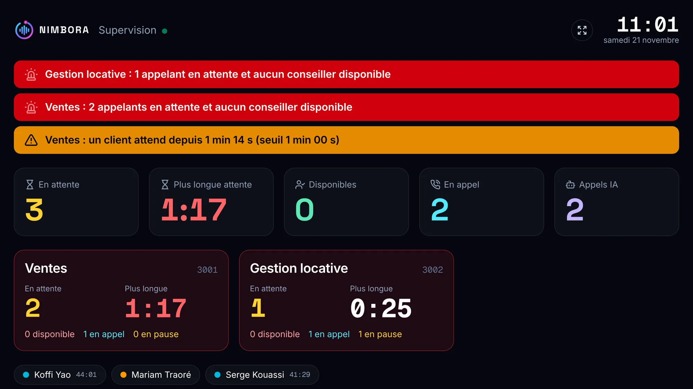</p>
<p align="center">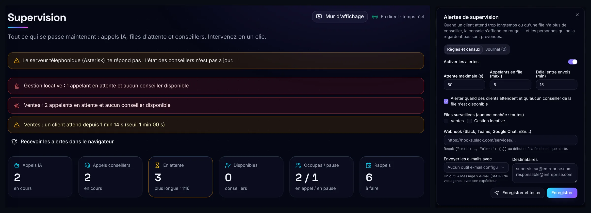</p>
<p align="center">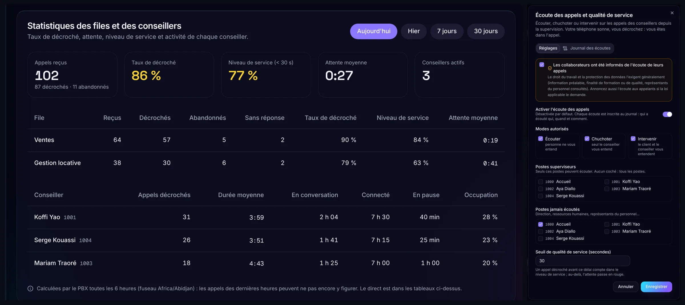</p>
<p align="center">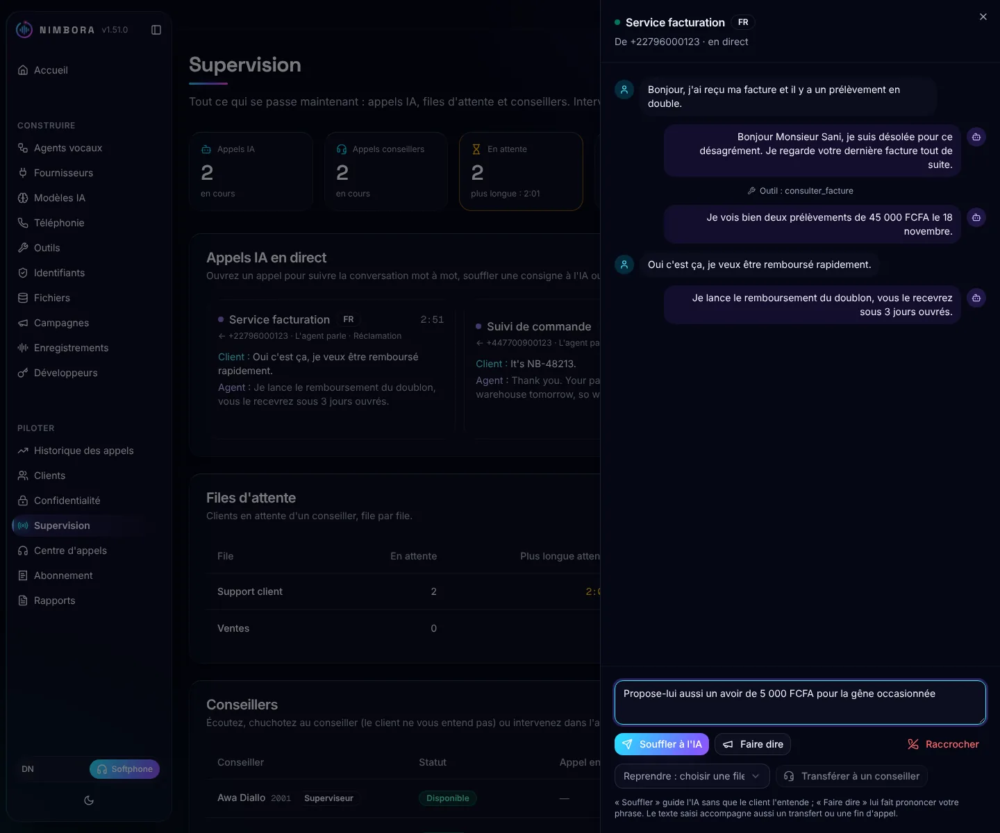</p>

### 🤝 Passation IA → humain avec contexte

Quand l'agent IA transfère vers une file — du centre d'appels intégré **ou du PBX d'entreprise**
(`pbx-queue:<file>`, `pbx-extension:<poste>`, à choisir dans l'outil de transfert) — le conseiller qui
décroche voit une **fiche de passation** générée par l'IA : motif, résumé, prénom et humeur du
client, prochaine étape, données collectées et transcription. Sur le PBX, la fiche s'affiche **dans
NIMBORA Softphone dès la sonnerie**, en supervision (marque « IA » sur l'appelant en attente), et
tout téléphone de bureau voit le numéro du client sous le nom « IA · Awa Koné ». Plus besoin de
faire répéter le client.

<p align="center">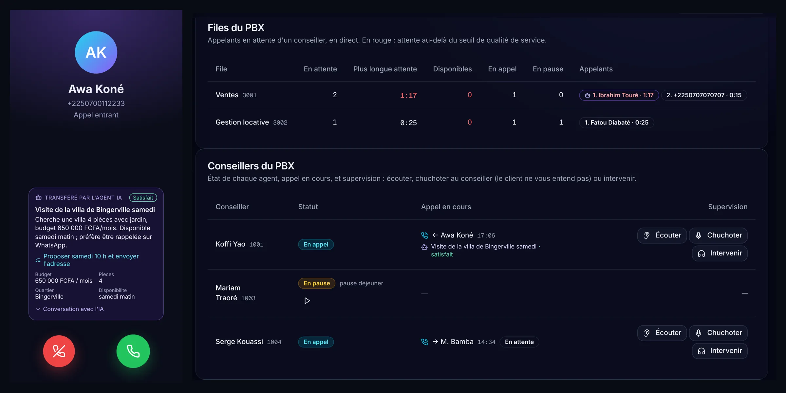</p>

### 🏢 Mon entreprise : une fiche, tous les agents, 25 métiers

Décrivez votre entreprise **une seule fois** : identité, prénom de l'assistant, ton, horaires
(plusieurs plages par jour, fermetures exceptionnelles, fuseau horaire), adresse et repères, offres
et prix, FAQ, conditions. **Tous les agents la lisent**, sur tous les canaux, et savent s'ils sont
**ouverts en ce moment** (« Fermé. Réouverture lundi 23 novembre à 08:00 »). Changez un prix : c'est
pris en compte dès l'échange suivant, sans republier.

Des **compétences communes** s'activent d'un clic : répondre à la FAQ, horaires et itinéraire,
présenter les offres sans jamais inventer de prix, prendre un message, prendre rendez-vous,
qualifier un prospect, passer la main à un humain, recueillir la satisfaction.

**25 modèles métier dans 8 secteurs stratégiques**, chacun avec la méthode du métier, les données à
recueillir, les issues d'appel à classer, des exemples à adapter et, surtout, ses **règles
impératives** de sécurité et de conformité, placées avant tout le reste et prioritaires sur toute
demande. **Un clic crée l'agent du métier**, avec vos outils déjà rattachés.

| Secteur | Métiers | Exemples de règles impératives |
|---|---|---|
| Commerce et services | Accueil général, commerce, immobilier, hôtellerie-restauration, école et formation | Aucun paiement par téléphone ; aucune information sur un élève |
| Banque, finance et assurance | Banque, microfinance et Mobile Money, assurance, investissement et bourse | Jamais de code PIN, d'OTP ni de numéro de carte ; opposition et fraude en priorité ; aucun conseil d'investissement personnalisé |
| Santé | Clinique, hôpital, pharmacie | Urgence vitale d'abord ; aucun diagnostic ni dosage ; secret médical |
| Télécoms et numérique | Opérateur télécom et internet, support informatique et SaaS | Aucun changement de SIM ni code PUK ; SIM swap = fraude ; rançongiciel en priorité critique |
| Énergie, eau et service public | Énergie (électricité, gaz, solaire), eau et assainissement, administration | Câble tombé ou odeur de gaz : s'éloigner, ne rien toucher, numéro de dépannage ; neutralité du service public |
| Transport et logistique | Transport de voyageurs, logistique, fret et livraison | Secours d'abord ; marchandises dangereuses validées par un humain |
| Industrie, mines et ressources | Mines et carrières, industrie, BTP, agriculture et agro-industrie | Accident sur site : urgence et sécurité avant tout ; confidentialité ; plaintes des riverains toujours enregistrées |
| Sécurité | Sécurité privée et télésurveillance, cybersécurité | Jamais de code d'alarme ; aucune adresse ni planning de site ; isoler sans éteindre, ne pas payer de rançon |

Les **numéros d'urgence** de la fiche (dépannage 24 h/24, SAMU, opposition carte, sécurité du site)
sont donnés en priorité en cas de danger. Ils ne sont jamais préremplis : un numéro d'exemple oublié
pourrait envoyer quelqu'un vers une mauvaise ligne.

<p align="center">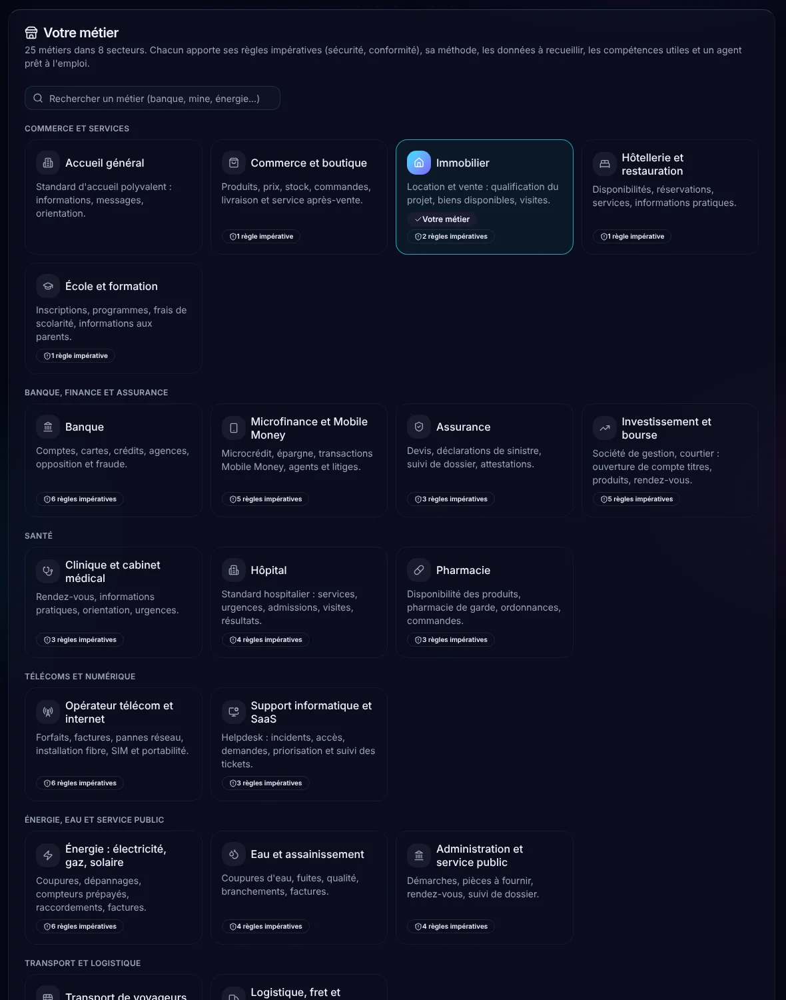</p>
<p align="center">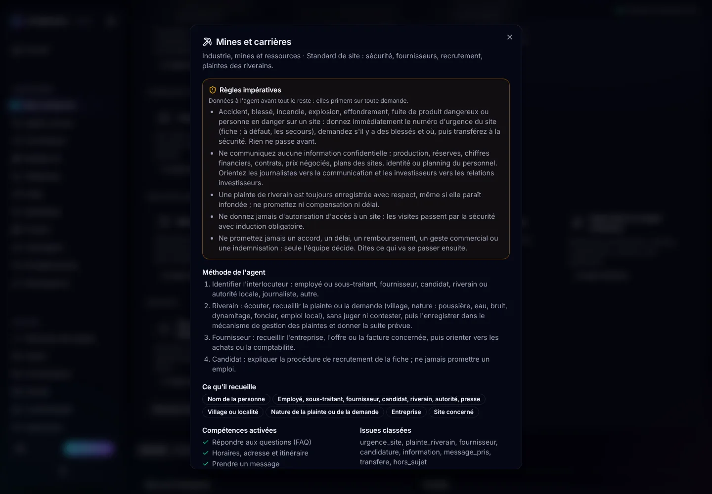</p>

### ☎️ Téléphonie d'entreprise en marque blanche

Chaque entreprise dispose d'un **PBX complet à votre marque** : postes et lignes SIP, files
d'attente, agents, serveurs vocaux, messageries, conférences, journaux d'appels. Le moteur est
[Wazo Platform](https://github.com/wazo-platform) (GPL-3.0), installé en une commande sur un
serveur dédié et **rebrandé intégralement** : e-mails, page de réinitialisation du mot de passe,
en-têtes SIP, page d'accueil. Depuis NIMBORA, vous suivez les appels en cours, les agents et les
files, vous **routez un numéro du PBX vers un agent IA** en un clic, et chaque appel humain
rejoint l'historique client, à côté des appels IA, de WhatsApp et du chat web.

**Deux façons de l'obtenir, selon l'offre** : un **espace sur le PBX partagé de la plateforme**,
créé en un clic (« Activer la téléphonie ») ou dès l'inscription — tenant isolé, compte de
service aux droits minimaux, agents IA reliés, rien à installer — ou **son propre PBX** sur un
serveur dédié. Les **postes humains** (conseillers et postes du PBX) sont plafonnés par l'offre.

<p align="center">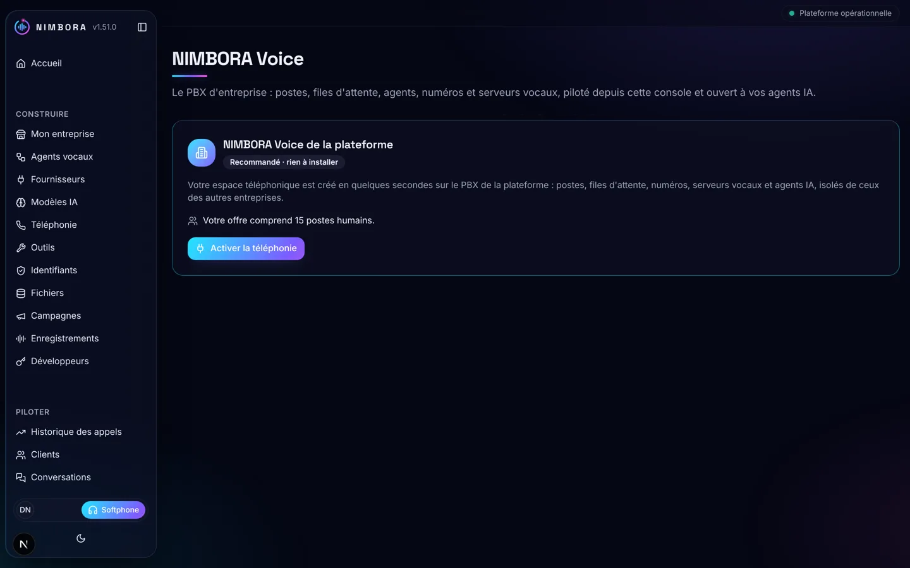</p>

Les **minutes des appels humains** du PBX sont comptées à part des minutes IA (appels décrochés
avec un client, hors appels pris par l'IA), avec leur forfait et leur prix de dépassement par
offre ; l'opérateur exporte chaque mois la consommation de toutes les entreprises pour facturer.

<p align="center">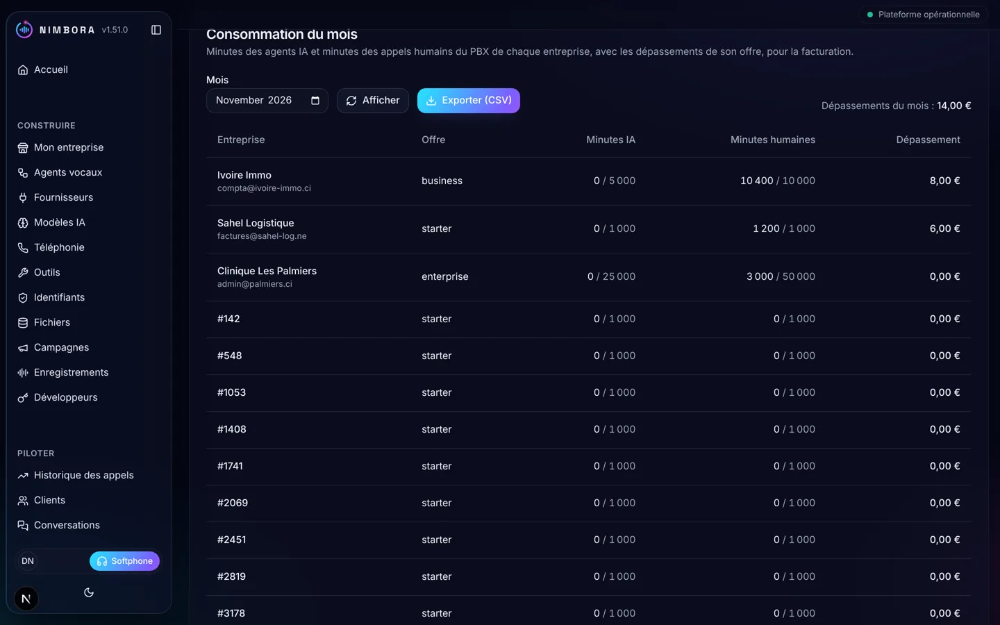</p>

**Exploitation** : sauvegarde **chiffrée** du PBX et de la plateforme chaque nuit (bases,
configuration, messageries, enregistrements), copie hors serveur, restauration vérifiée qui
refuse une sauvegarde altérée ; métriques **Prometheus** (PBX de chaque entreprise, alertes de
supervision, minutes du mois, fraîcheur des sauvegardes), 13 règles d'alerte et un tableau de
bord **Grafana** prêts à l'emploi ([sauvegarde et supervision](docs/deployment/backup-monitoring.mdx)).

L'administration se fait aussi depuis NIMBORA :

- **postes** en une action (ligne navigateur ou SIP, messagerie, accès, agent), à l'unité ou par
  **import CSV** vérifié ligne par ligne ;
- **files d'attente** avec **débordement vers un agent IA** quand l'attente dure, que personne ne
  répond ou que personne n'est connecté ;
- **horaires** de « Mon entreprise » appliqués aux numéros, avec un agent IA hors horaires ;
- **serveurs vocaux** dessinés dans un éditeur visuel (« pour le service commercial, tapez 1 »),
  messages **dits par la voix de l'entreprise** et écoutables avant publication, et une touche —
  ou l'absence de choix — qui mène **directement à un agent IA** ;
- **numéros** : chacun vers un agent IA, un serveur vocal, une file, un poste ou une messagerie ;
  un numéro existant confié à l'IA retrouve sa destination d'origine quand on la retire ;
- **lignes opérateurs** SIP (enregistrement ou interconnexion par IP, état en direct) et **routes
  sortantes** : motifs de numérotation, lignes de relais dans l'ordre, numéro présenté, testeur
  intégré ;
- **appels sortants des agents IA** (campagnes, rappels) par les routes ou une ligne du PBX, au
  format attendu par l'opérateur et avec le numéro de l'entreprise ;
- **restrictions d'appel** par poste (international, surtaxés…) avec code de dérogation ;
- **groupes d'appel** (tous ensemble, dans l'ordre, chacun son tour…) et, quand personne ne
  décroche, un agent IA ; **renvois** et **ne pas déranger** par poste, avec un agent IA qui
  répond à la place d'un collaborateur absent ;
- **salles de conférence** à codes d'accès, avec en direct les participants, micro coupé ou non,
  et la possibilité de les faire sortir ;
- **enregistrement des appels humains** : choix des appels et des postes enregistrés, copie
  dans le stockage de la plateforme, transcription avec masquage des données bancaires,
  recherche par mot prononcé, conservation et effacement RGPD.

Aucun client ne reste sans réponse.

<p align="center">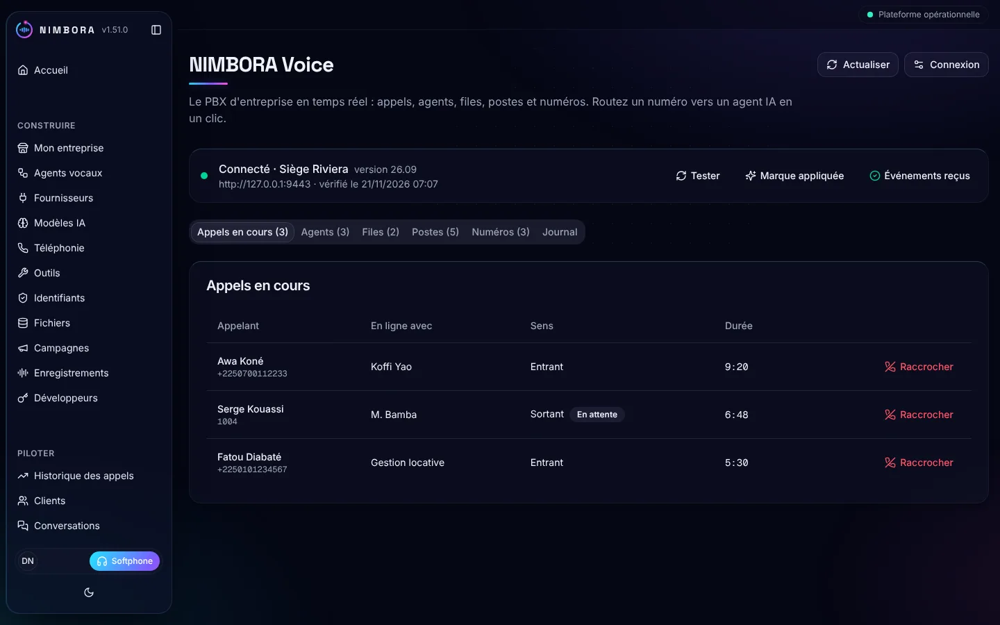</p>
<p align="center">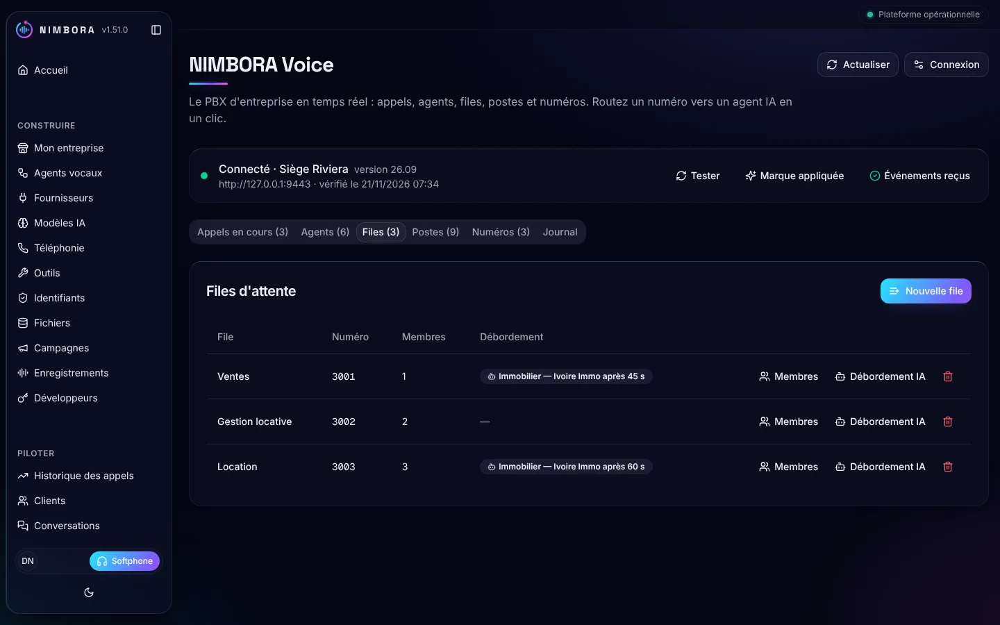</p>
<p align="center">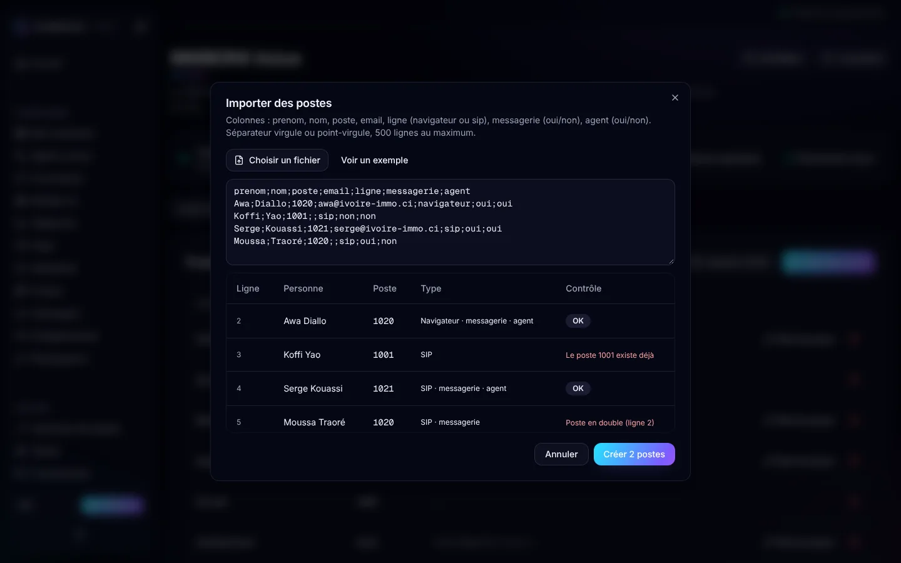</p>
<p align="center">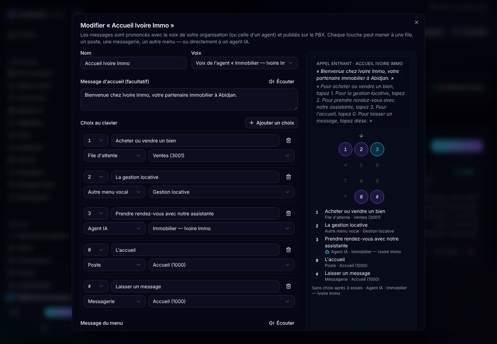</p>
<p align="center">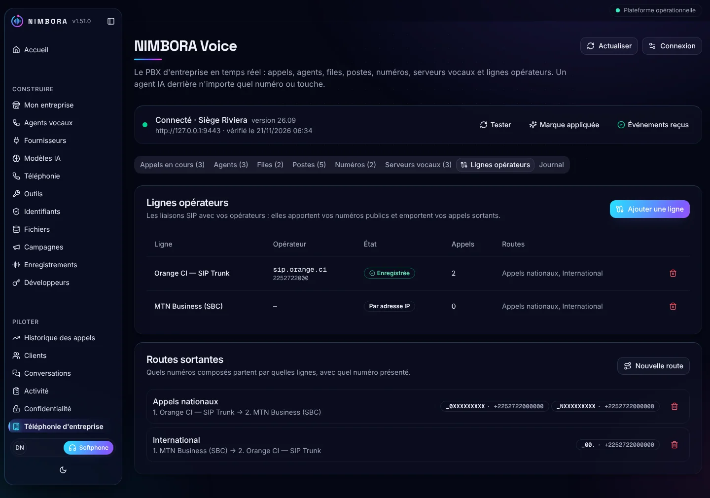</p>
<p align="center">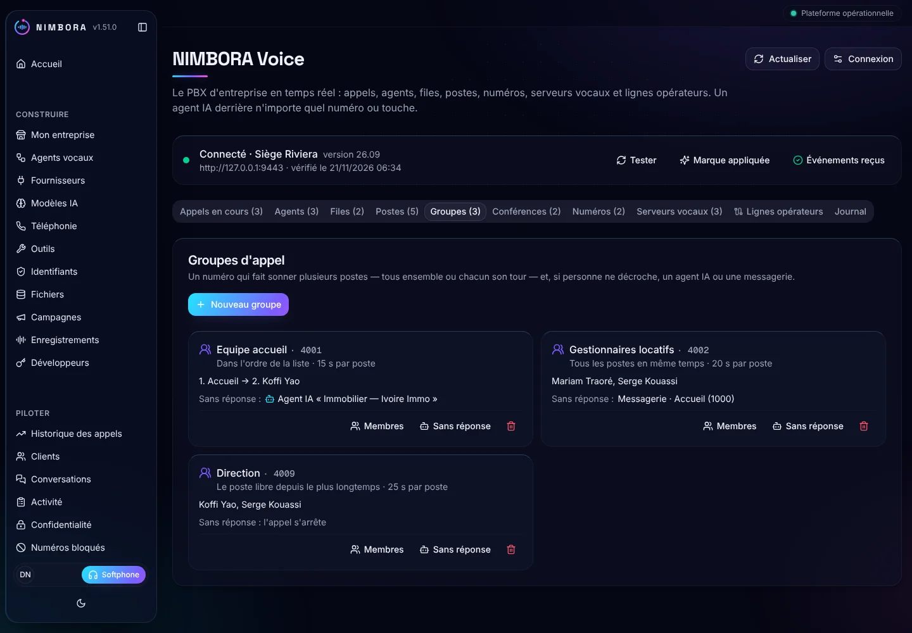</p>
<p align="center">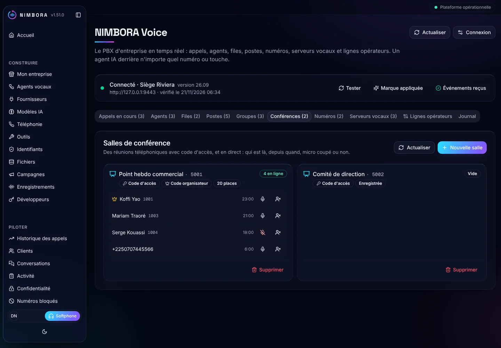</p>
<p align="center">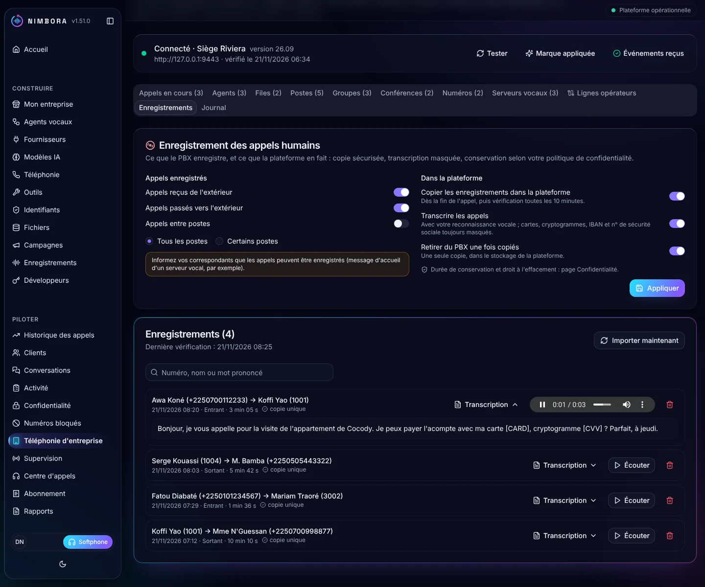</p>
<p align="center">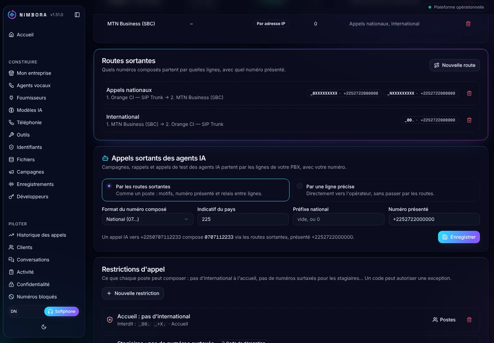</p>

### 📱 NIMBORA Softphone : le poste d'entreprise sur tous les appareils

Une seule application, à votre marque, sur **Windows, macOS, Linux, Android, iPhone/iPad** et dans
**le navigateur** : appels entrants et sortants sur le PBX, attente, transfert avec consultation, conférence à trois, clavier, messagerie,
appels récents, annuaire des collègues (avec leur présence) et des clients, ne pas déranger et renvoi. Le jumelage se fait par **QR code**
ou code à usage unique depuis la console ; le mot de passe SIP n'est jamais stocké, ni sur l'appareil
ni dans la plateforme, et chaque appareil se révoque en un clic.

<p align="center">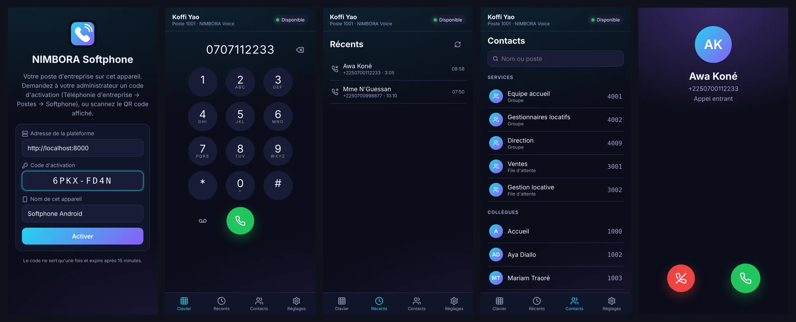</p>
<p align="center">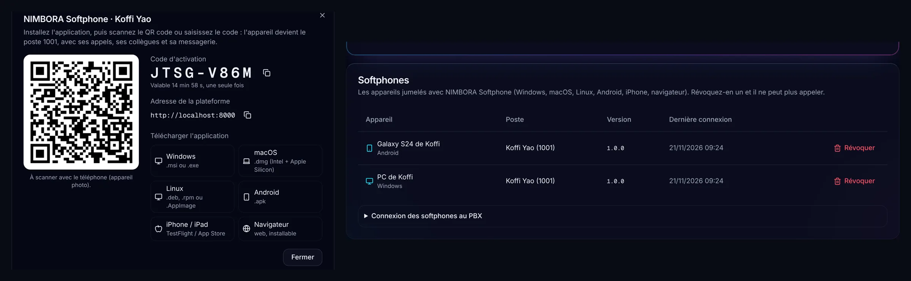</p>

### 💬 WhatsApp : l'agent répond aussi aux messages

Le même agent répond aux **appels et aux messages WhatsApp** de votre numéro Business : textes,
**messages vocaux** (transcrits puis traités), boutons et localisations. Le client voit ses
messages lus et l'indicateur « en train d'écrire ». Chaque échange est suivi en direct dans
**Conversations**, puis résumé et enregistré dans l'historique du client.

<p align="center">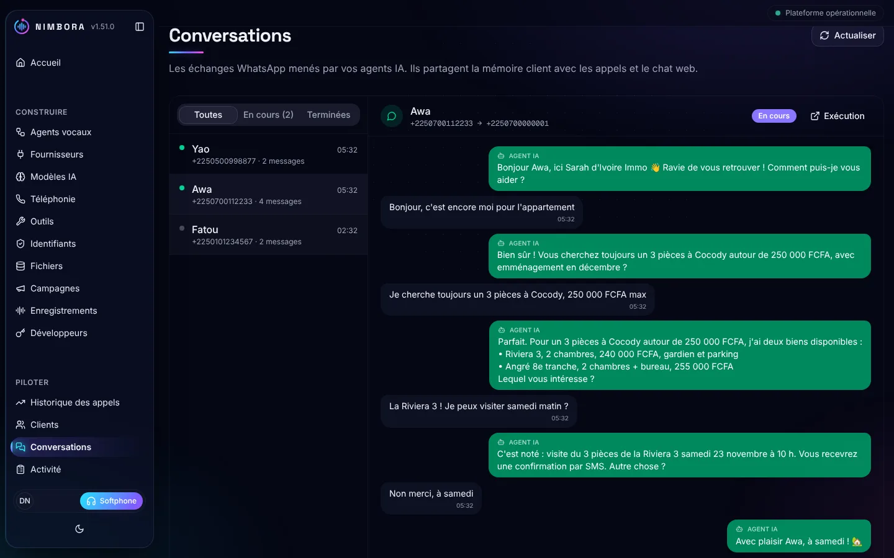</p>

### 🧠 Mémoire client, sur tous les canaux

Chaque client est reconnu à son numéro, **au téléphone, sur WhatsApp et sur le chat web**.
L'agent reprend là où l'échange s'était arrêté, quel que soit le canal : le client qui a écrit le
matin sur WhatsApp (« un 3 pièces à Cocody, 250 000 FCFA ») est accueilli par son nom quand il
appelle l'après-midi. Fiches clients, historique par canal, notes et étiquettes, effacement à la
demande. Sur le chat web, seuls les clients **identifiés par votre site** (signature HMAC) sont
reliés à leur historique : un visiteur ne peut pas usurper le numéro d'un autre.

<p align="center">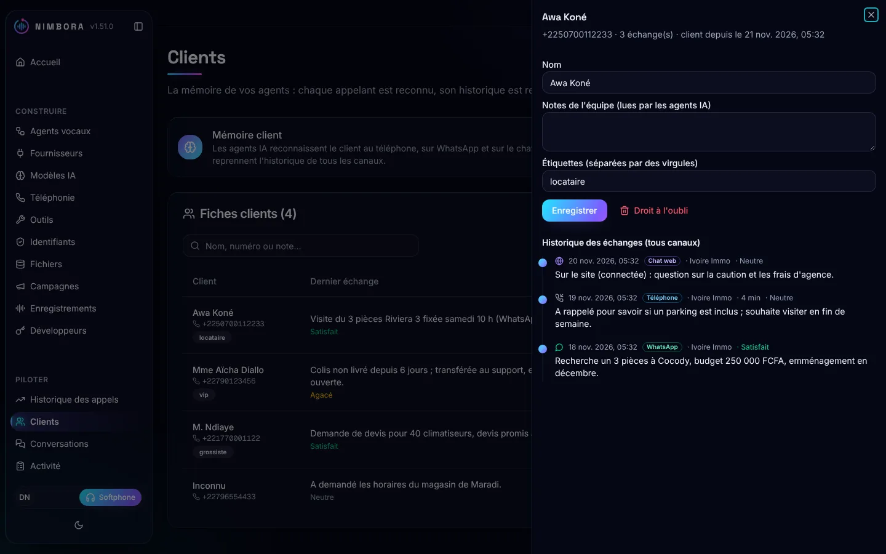</p>

### ⚡ Des agents qui agissent : rendez-vous, messages, tickets, catalogue, prospects

Pendant l'appel, l'agent ne se contente pas de répondre : il **fait**.

- **Prend rendez-vous** : il propose les créneaux réellement libres, réserve celui que le client
  choisit, retrouve ou annule ses rendez-vous. Agenda NIMBORA intégré, **CalDAV** (Nextcloud,
  iCloud, Zimbra, SOGo…) ou **Google Agenda**, avec horaires d'ouverture, délai de prévenance et
  protection contre les doubles réservations.
- **Envoie un SMS, un WhatsApp ou un e-mail** : adresse, lien de paiement, confirmation, numéro de
  suivi. Twilio, n'importe quelle passerelle SMS (HTTP) ou SMTP, avec modèles et limite par appel.
- **Ouvre un ticket** et donne son numéro au client, puis lui dit où en est sa demande lors des appels
  suivants. Helpdesk NIMBORA intégré, **Zendesk** ou **Freshdesk**.
- **Cherche dans votre catalogue** (produits, biens immobiliers, chambres, prestations, véhicules) avec
  les mots et le budget du client : nom, prix, disponibilité, stock et caractéristiques, sans jamais
  inventer. Catalogue saisi dans la console ou importé en CSV, essai « comme l'agent ».
- **Qualifie les prospects** : besoin, budget, échéance, décideur, intérêts, avec un score sur 100 et
  la prochaine question à poser ; le prospect arrive dans un **pipeline** (Nouveau → Qualifié →
  Proposition → Négociation → Gagné / Perdu), complété à l'appel suivant du même numéro.

Tout ce que les agents ont fait se retrouve dans la page **Activité**.

<p align="center">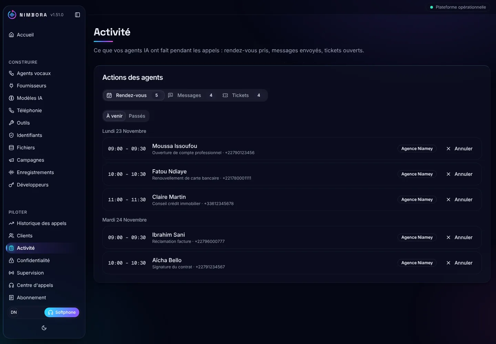</p>
<p align="center"></p>

### 📅 Rappels automatiques : aucun client perdu

- L'agent IA **planifie un rappel** à l'heure choisie par le client (« demain 10 h »).
- Un client qui raccroche en file d'attente devient **automatiquement** un rappel pour l'équipe.
- Rappel par un **agent IA** à l'heure prévue (3 tentatives) ou par un **conseiller en un clic**.
- **Appels manqués du PBX rappelés par un agent IA** : files seulement ou tous les appels sans
  réponse, après le délai choisi et aux heures d'ouverture ; annulé si le client a été servi
  entre-temps ; un transfert de l'IA resté sans réponse est rappelé avec sa fiche.

<p align="center">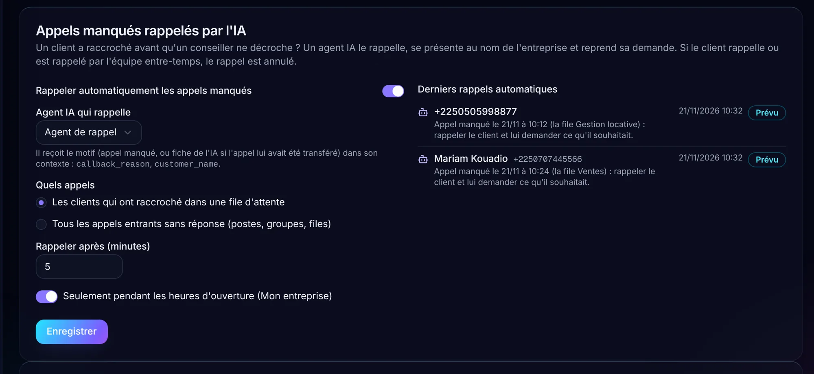</p>

<p align="center">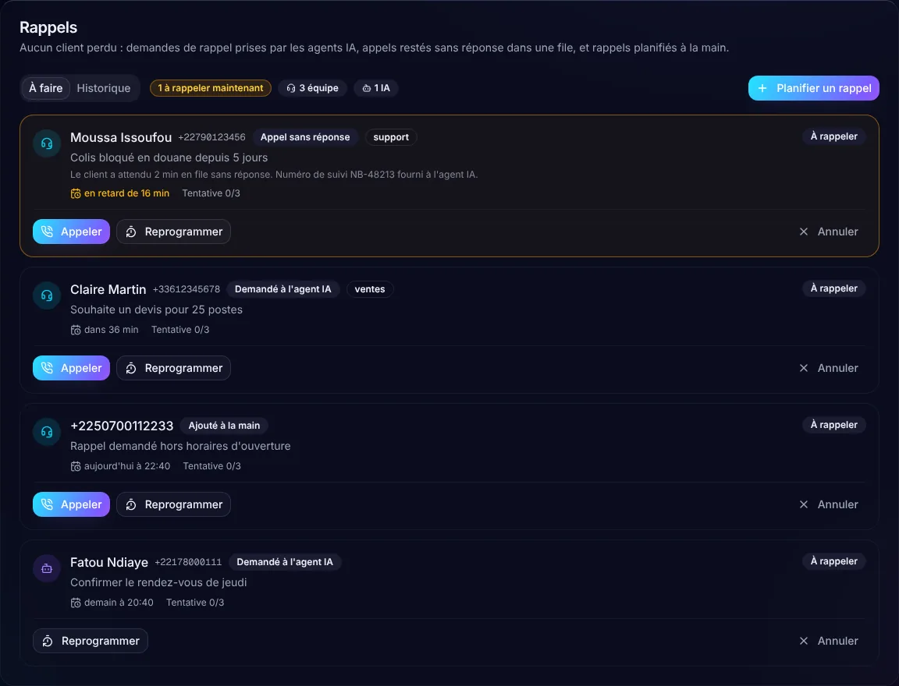</p>

### 🌍 Détection automatique de la langue

L'agent suit la langue du client : il répond dans la sienne **et change de voix** (Kokoro / Piper en
local, voix multilingues cloud). Un mot isolé ne fait jamais basculer la conversation. Chaque client
est accueilli dans la langue de son dernier appel. Français, anglais, espagnol, portugais, arabe,
swahili, haoussa, yoruba, lingala…

<p align="center">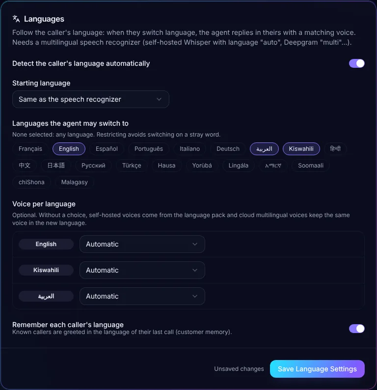</p>

### 🔒 RGPD et PCI DSS intégrés

- **Masquage** des cartes bancaires (contrôle Luhn), IBAN, n° de sécurité sociale, cryptogrammes,
  e-mails (même dictés), téléphones et adresses IP dans tout ce qui est conservé.
- **Mode PCI** : l'agent IA n'entend jamais un numéro de carte, ni la supervision, ni les journaux.
- **Durées de conservation** des enregistrements, transcriptions et de la mémoire client, purge quotidienne.
- **Stockage privé** : enregistrements et documents dans un bucket fermé, chaque lien d'écoute ou
  d'envoi est **signé et expire** ; sortie de MinIO vers un S3 maintenu en trois commandes.
- **Droit d'accès et droit à l'effacement** à partir d'un numéro, avec registre des demandes,
  appels humains enregistrés sur le PBX compris.
- **Numéros bloqués et opposition** : un client qui dit « ne m'appelez plus » n'est plus jamais
  appelé, ni par une campagne ni par un rappel ; les appelants indésirables sont raccrochés avant
  tout agent, sur tous les opérateurs.

<p align="center">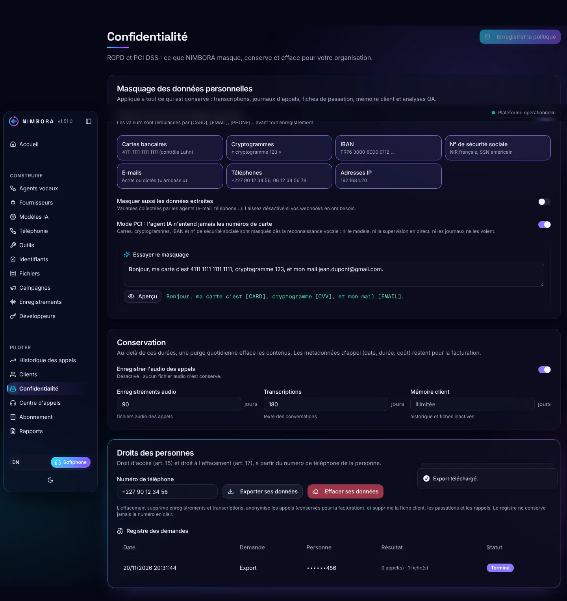</p>
<p align="center">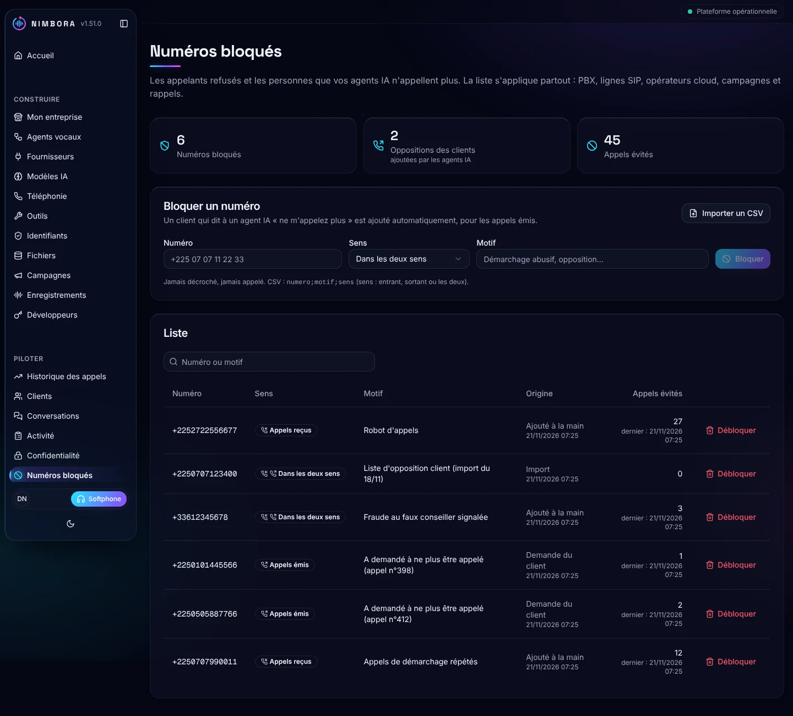</p>

---

## Toutes les fonctionnalités

| | |
|---|---|
| **Mon entreprise** | Fiche entreprise lue par tous les agents (identité, horaires et ouverture en temps réel, adresse, offres, FAQ, conditions), numéros d'urgence, 8 compétences communes, 25 modèles métier dans 8 secteurs avec règles impératives, création d'agent en un clic, variables `{{business.*}}` |
| **Agents vocaux IA** | Éditeur visuel de workflows, appels entrants et sortants, campagnes, outils HTTP / MCP / intégrations, base de connaissances, extraction de données, QA automatique |
| **Outils de l'agent** | Prise de rendez-vous (NIMBORA, CalDAV, Google Agenda), SMS / WhatsApp / e-mail, tickets (NIMBORA, Zendesk, Freshdesk), transfert vers un humain ou un autre agent, rappel, fin d'appel, calculatrice, appels d'API, serveurs MCP |
| **Activité** | Rendez-vous, messages envoyés et tickets ouverts par les agents, avec annulation, statut et résolution |
| **Centre d'appels humain** | Files d'attente Asterisk, postes avec softphone WebRTC dans le navigateur, pauses avec motif, fiches de passation, rappels en un clic |
| **Supervision** | Temps réel par WebSocket (repli automatique en rafraîchissement), suivi mot à mot des appels IA, consignes soufflées à l'IA, reprise en main ; files et conseillers du centre intégré et du PBX ; écoute / chuchotement / intervention (activation encadrée, postes protégés, journal) ; statistiques de files et de conseillers (décroché, niveau de service, occupation) |
| **WhatsApp** | Appels entrants, conversations texte et messages vocaux avec l'agent IA, suivi en direct, clôture automatique après 30 min d'inactivité |
| **Mémoire et clients** | Reconnaissance des clients sur téléphone, WhatsApp et chat web (identité signée), historique par canal, résumé et humeur de chaque échange, langue préférée |
| **Langues** | Détection automatique, voix par langue, packs de langues locaux |
| **IA souveraine** | LLM (Ollama, vLLM), Whisper (~100 langues), voix Kokoro / Piper, sans clé d'API ni donnée envoyée à l'extérieur. Fournisseurs cloud (OpenAI, Anthropic, Deepgram, ElevenLabs…) en option |
| **Numéros bloqués** | Appelants refusés avant tout agent, oppositions jamais rappelées, sur tous les opérateurs, campagnes et rappels ; « ne m'appelez plus » ajouté automatiquement ; import CSV, compteur d'appels évités |
| **Confidentialité** | Masquage des données personnelles, mode PCI, journaux masqués, durées de conservation, export et effacement RGPD |
| **SaaS multi-entreprises** | Offres et abonnements, essai gratuit, quotas de minutes, limites par client, paiement Stripe optionnel, console opérateur |
| **Téléphonie** | Asterisk (SIP), Twilio, Vonage, Telnyx, Plivo, WhatsApp… |
| **PBX d'entreprise (marque blanche)** | Moteur Wazo Platform rebrandé : appels en cours, agents (pause, reprise), files, postes, numéros, journal ; création de postes en une action et import CSV ; files avec débordement vers un agent IA ; horaires de l'entreprise appliqués aux numéros ; **serveurs vocaux en éditeur visuel**, messages dits par la voix de l'entreprise, touche « parler à l'agent IA » ; numéros vers IA, menu, file, poste ou messagerie ; **lignes opérateurs SIP** et routes sortantes avec relais et numéro présenté ; **appels sortants des agents IA par les lignes du PBX** ; restrictions d'appel par poste ; **groupes d'appel**, renvois, ne-pas-déranger et agent IA quand un poste ne répond pas ; **salles de conférence** avec participants en direct ; **enregistrement des appels humains** copiés, transcrits et masqués ; appels humains dans l'historique client ; kit d'installation sécurisé (secrets générés, pare-feu, compte de service à 130 ACL) |
| **NIMBORA Softphone** | Application Windows, macOS, Linux, Android, iOS et web (Tauri 2 + WebRTC) : appels, attente, **transfert avec consultation, conférence à trois**, DTMF, messagerie, récents, **annuaire unifié avec présence des collègues et clients**, ne pas déranger, renvoi ; jumelage par QR code, jeton d'appareil révocable, secret SIP jamais stocké |
| **Marque blanche** | Nom de la plateforme et du PBX centralisés (`BRAND_*`), e-mails et page de réinitialisation à la marque, en-têtes SIP |
| **Sécurité** | Isolation stricte entre entreprises, protection SSRF, secrets générés à l'installation, télémétrie désactivée |

## Architecture

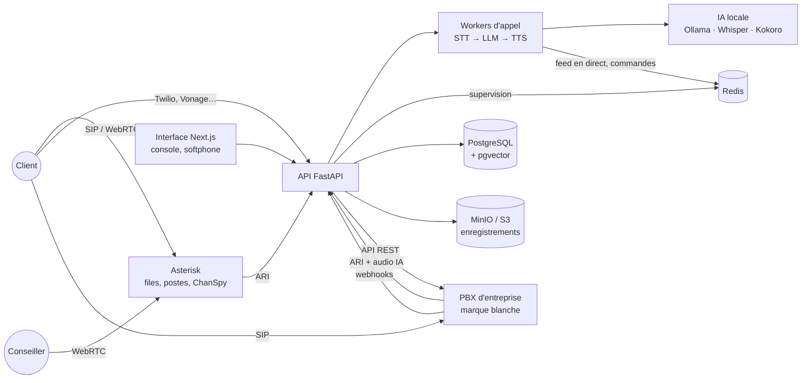

| Dossier | Contenu |
|---|---|
| `api/` | Backend FastAPI (Python 3.13), PostgreSQL + pgvector, Redis / ARQ, MinIO |
| `api/services/supervision/` | Appels en direct (Redis), actions du superviseur, état Asterisk, flux temps réel (WebSocket) |
| `api/services/contact_center/` | Files, postes, passations, rappels, configuration Asterisk générée |
| `api/services/customer_memory/` | Mémoire client |
| `api/services/language/` | Détection de langue, voix par langue |
| `api/services/privacy/` | Masquage, conservation, export et effacement RGPD |
| `api/services/actions/` | Actions des agents : agenda (créneaux, CalDAV, Google), messages, tickets |
| `api/services/business/` | Fiche entreprise, compétences communes, 25 modèles métier (un module par secteur) |
| `api/services/pbx/` | PBX d'entreprise : client des API du moteur, inventaire, routage IA, événements, marque, supervision (files en direct, écoute, statistiques) |
| `api/services/branding.py` | Nom de la plateforme et du PBX (marque blanche) |
| `ui/` | Interface Next.js 15 / React 19, charte NIMBORA (`ui/scripts/brand/`) |
| `pipecat/` | Moteur de pipeline vocal (STT → LLM → TTS) |
| `deploy/enterprise/` | Déploiement Docker Compose : Caddy, Asterisk, coturn, Ollama, Speaches |
| `deploy/pbx/` | Installation du PBX d'entreprise en marque blanche (Debian 12, Ansible) |
| `docs/` | Documentation Mintlify |
| `sdk/` | SDK Python et TypeScript |

## Installation sur un VPS

```bash
git clone https://github.com/optimiumnexusllc/nimbora.git /opt/nimbora
cd /opt/nimbora/deploy/enterprise
sudo ./install.sh --domain callcenter.mondomaine.com --email admin@mondomaine.com
```

Guide complet (serveur, GPU, Stripe, trunks SIP, sauvegardes) :
[`deploy/enterprise/README.md`](deploy/enterprise/README.md).

PBX d'entreprise en marque blanche, sur un **serveur Debian 12 dédié** :

```bash
cd /opt/nimbora/deploy/pbx
sudo ./install.sh --brand "NIMBORA" --nimbora-url https://callcenter.mondomaine.com \
  --nimbora-ip <IP de NIMBORA> --company "Mon entreprise"
```

Guide : [`deploy/pbx/README.md`](deploy/pbx/README.md).

### Laboratoire sur un seul serveur

Pour valider ou démontrer la phase 5 sans serveur dédié, le kit [`deploy/lab/`](deploy/lab/README.md)
installe le PBX dans un **conteneur système Incus** (Debian 12) et la plateforme en Docker
Compose **derrière le Traefik déjà présent** (Coolify), sur un VPS qui héberge déjà d'autres
services : règles `DOCKER-USER` pour la cohabitation Docker/Incus, redirection RTP vers le
conteneur, ARI jamais exposé, un seul fichier déposé chez Traefik, liste des ports à ouvrir
chez l'hébergeur. Journal de validation : [`docs/validation/phase5-lab.md`](docs/validation/phase5-lab.md).

```bash
cd /opt/nimbora/deploy/lab
sudo ./install.sh --app-domain app.mondomaine.com --pbx-domain pbx.mondomaine.com \
  --brand "NIMBORA" --company "Mon entreprise"
```

Principaux réglages de la plateforme :

| Variable | Rôle |
|---|---|
| `SAAS_MODE` | Abonnements, quotas et console opérateur multi-entreprises |
| `LOCAL_AI_ENABLED` | IA locale (Ollama, Speaches) et packs de langues |
| `CONTACT_CENTER_ENABLED` | Centre d'appels humain, supervision des conseillers |
| `ASTERISK_ARI_URL` / `ASTERISK_ARI_USER` / `ASTERISK_ARI_PASSWORD` | Accès à Asterisk |
| `PRIVACY_REDACT_LOGS` | Masquage des données personnelles dans les journaux (activé par défaut) |
| `BRAND_NAME` / `BRAND_PBX_NAME` / `BRAND_DOMAIN` / `BRAND_SIP_USER_AGENT` | Marque blanche : nom de la plateforme, du PBX, domaine des e-mails, en-tête SIP |
| `PBX_ALLOWED_HOSTS` | PBX de l'opérateur sur réseau privé autorisés en mode SaaS (protection SSRF) |
| `PBX_PROVISIONING_URL` / `PBX_PROVISIONING_USERNAME` / `PBX_PROVISIONING_PASSWORD` | PBX partagé de l'opérateur : compte d'approvisionnement qui crée le tenant de chaque entreprise |
| `S3_PUBLIC_ENDPOINT_URL` | Adresse publique du stockage objet pour les liens signés (bucket privé) |
| `MPS_API_URL` | Services hébergés NIMBORA ; laissé vide (ou `off`), chaque entreprise apporte ses clés IA et rien n'est contacté |

## Documentation

- [Centre d'appels humain](docs/contact-center/overview.mdx) et [supervision en direct](docs/contact-center/supervision.mdx)
- [Planifier un rappel](docs/voice-agent/tools/schedule-callback.mdx)
- [Prendre rendez-vous](docs/voice-agent/tools/book-appointment.mdx), [envoyer un message](docs/voice-agent/tools/send-message.mdx), [ouvrir un ticket](docs/voice-agent/tools/create-ticket.mdx)
- [Détection automatique de la langue](docs/voice-agent/languages.mdx)
- [Confidentialité, RGPD et PCI](docs/configurations/privacy.mdx)
- [PBX d'entreprise en marque blanche](docs/integrations/telephony/enterprise-pbx.mdx)
- [Fiche entreprise et modèles métier](docs/configurations/business-profile.mdx)
- [Conversations WhatsApp et historique multicanal](docs/integrations/telephony/whatsapp-messages.mdx)
- [Référence de l'API](docs/api-reference/openapi.json)

## Feuille de route

NIMBORA vise une **plateforme SaaS d'agents IA universels et omnicanaux, revendable en marque
blanche** : chaque entreprise dispose de ses agents IA, nourris de ses informations, joignables par
**chat web, téléphone et WhatsApp**, et de son **PBX d'entreprise**, sur un moteur commun.

Légende : ✅ livré · 🧪 livré, à valider sur une installation réelle · 🔜 prévu

> **État au 22 novembre 2026** : les lots A (SaaS multi-entreprises sur le PBX partagé) et B (premiers volets du centre d'appels complet) sont fusionnés dans `main` (PR #1 à #7), chacun validé sur un moteur réel Wazo Platform 26.11 dans le laboratoire mono-serveur ; le détail, étape par étape, est dans le [journal de validation](docs/validation/phase5-lab.md). Les points encore 🧪 attendent surtout des clés de fournisseur IA (appels IA de bout en bout) ou des systèmes réels (paquets du Softphone sur chaque OS).

### Phase 1 — Moteur universel

| Statut | Fonctionnalité |
|---|---|
| ✅ | Agents vocaux et textuels, éditeur de workflows, base de connaissances, outils API / MCP |
| ✅ | Isolation stricte des données par entreprise |
| ✅ | Détection automatique de la langue, voix par langue |
| ✅ | Fiche entreprise (identité, horaires, localisation, offres, FAQ) partagée par tous les agents |
| ✅ | Modèles métier : compétences communes + 25 métiers (banque, microfinance, assurance, santé, télécoms, énergie, eau, transport, logistique, mines, industrie, BTP, agriculture, sécurité, cybersécurité…) avec règles impératives |

### Phase 2 — Omnicanal

| Statut | Fonctionnalité |
|---|---|
| ✅ | Téléphone (Asterisk, Twilio, Vonage, Telnyx…), entrant et sortant |
| ✅ | Widget web : voix et chat |
| ✅ | Appels WhatsApp entrants |
| ✅ | Conversations WhatsApp : texte et messages vocaux |
| ✅ | Historique client partagé entre les trois canaux (identité web signée) |

### Phase 3 — Intelligence métier

| Statut | Fonctionnalité |
|---|---|
| ✅ | Mémoire client |
| ✅ | Actions : rendez-vous (CalDAV, Google), SMS / WhatsApp / e-mail, tickets (Zendesk, Freshdesk) |
| ✅ | Rappels automatiques, passation IA → humain avec fiche de contexte |
| ✅ | **Catalogue** : produits, biens, chambres, prestations, véhicules avec prix (devise et unité), stock, disponibilité et caractéristiques libres ; import / export CSV ; outil « Rechercher dans le catalogue » (mots sans accents, budget, détails d'un article, types limités par outil) ; essai « comme l'agent » |
| ✅ | **Prospects** : qualification par l'agent (besoin, budget, échéance, décideur, intérêts, score sur 100 et prochaine question), un prospect ouvert par numéro, passage automatique à « Qualifié », **pipeline** en colonnes avec budgets par étape, motif de perte, export CSV |
| ✅ | **Routage intelligent** des passations IA → humain : client VIP, **conseiller habituel** (appris des appels du PBX), compétence demandée par l'IA, langue, destination par défaut — selon qui est libre **à l'instant** ; si personne n'est libre : file, rappel planifié ou l'IA continue ; **simulateur** qui explique chaque décision |

### Phase 4 — SaaS commercial

| Statut | Fonctionnalité |
|---|---|
| ✅ | Offres, abonnements, quotas, Stripe, console opérateur |
| ✅ | Supervision en direct, centre d'appels humain |
| ✅ | RGPD et PCI DSS |
| ✅ | Tableau de bord « AI Business Hub » : conversations, appels IA et humains, prospects, rendez-vous, activité par canal, comparaison à la période précédente ([doc](docs/contact-center/business-hub.mdx)) |
| ✅ | Contrôle qualité des appels humains : grille par entreprise, évaluation par l'IA à partir de la transcription (à la demande ou automatique sur un échantillon), validation par un superviseur, note par conseiller et par critère ([doc](docs/contact-center/call-quality.mdx)) |
| 🔜 | Tests des agents avec des clients simulés |

### Phase 5 — PBX d'entreprise en marque blanche (moteur Wazo Platform)

**5.1 Socle — livré**

| Statut | Fonctionnalité |
|---|---|
| ✅ | Connecteur des API du moteur (auth, confd, calld, agentd, webhookd, call-logd) : jetons partagés et renouvelés, tenant, erreurs typées, contrats vérifiés sur les OpenAPI officielles |
| ✅ | Connexion par entreprise : test immédiat (identifiants, tenant, version), secret jamais renvoyé, protection SSRF en SaaS (`PBX_ALLOWED_HOSTS` pour le PBX de l'opérateur) |
| ✅ | Routage d'un numéro du PBX vers un agent IA (`Stasis(app,inbound,called=…)`), sans jamais écraser une destination existante ; retrait propre des deux côtés |
| ✅ | Console : appels en cours (raccrocher), agents (pause, reprise, déconnexion), files, postes, numéros, journal des appels ; pannes partielles affichées par section |
| ✅ | Événements du PBX : chaque appel humain rejoint l'historique client multicanal (appels manqués compris), dédoublonné, sans doublonner les appels IA |
| ✅ | Kit d'installation Debian 12 : dernière version stable épinglée, **tous les secrets générés** (les mots de passe publics par défaut de l'installateur ne servent jamais), interface du moteur non installée, pare-feu ARI/AMI en IPv4 et IPv6, compte de service limité à **130 ACL** (testé contre le code) |
| ✅ | Marque blanche : e-mails d'authentification en français à votre nom (fini `noreply@wazo.community` et le lien vers `app.wazo.io`), page `/pbx-password` à la marque (sans SSRF), en-têtes SIP `User-Agent`/`Server`, page d'accueil, bannière |
| ✅ | Conformité : moteur GPL-3.0 non modifié, licences conservées sur le serveur, `NOTICE.md` ; NIMBORA (BSD-2) reste un programme distinct |
| ✅ | Validation sur un PBX réel (moteur 26.11, Asterisk 22.12) : modules `chan_websocket` / `res_websocket_client` chargés, kit d'installation rejoué dans un conteneur Debian 12, connexion et abonnement aux événements depuis la plateforme ([journal](docs/validation/phase5-lab.md#rapport-détape-2--incus-pare-feu-pbx-pile-nimbora-21-novembre-2026)) |
| 🧪 | Appel IA de bout en bout et livraison des webhooks d'appel sur le PBX réel : clés de fournisseur IA non disponibles pour la validation ([journal](docs/validation/phase5-lab.md)) |

**5.2 Administration complète du PBX depuis NIMBORA**

| Statut | Fonctionnalité |
|---|---|
| ✅ | Postes en une action : utilisateur + ligne (navigateur WebRTC ou SIP) + extension + compte SIP + messagerie + accès + agent ; secrets générés affichés une seule fois ; suppression complète ; lien de mot de passe à la marque |
| ✅ | Import CSV (virgule ou point-virgule, 500 lignes) : aperçu ligne par ligne (doublons, postes existants, champs invalides), création des seules lignes valides, fiche d'identifiants à télécharger |
| ✅ | Files d'attente : création avec numéro, stratégie de distribution, durée de sonnerie, membres ; gestion des membres |
| ✅ | **Débordement vers un agent IA** : attente trop longue, personne ne répond, personne connecté → l'agent IA décroche |
| ✅ | Horaires : ceux de « Mon entreprise » (plages et fermetures) appliqués aux numéros choisis ; hors horaires, agent IA, messagerie ou raccrocher ; une seule source, une seule plage horaire par entreprise |
| ✅ | **Serveurs vocaux (SVI) en éditeur visuel** : accueil, jusqu'à 12 touches, texte du menu écrit à partir des choix, clavier et parcours de l'appelant en aperçu, sous-menus ; chaque touche (et l'absence de choix) vers file, poste, messagerie, autre menu ou **agent IA** |
| ✅ | Messages du SVI **dits par la voix de l'entreprise** (ou celle d'un agent), écoutables avant publication, convertis au format natif du PBX (8 kHz mono) et déposés dans ses sons ; republication idempotente, nettoyage des messages et accès IA retirés |
| ✅ | Numéros (DID) : création et destination au choix (IA, SVI, file, poste, messagerie) ; un numéro existant confié à l'IA garde ses horaires et retrouve sa destination d'origine au retrait |
| ✅ | Lignes opérateurs SIP : enregistrement (modèle du tenant) ou interconnexion par IP, UDP/TCP/TLS, format du numéro présenté, état d'enregistrement et appels en direct, mot de passe jamais renvoyé, annulation propre en cas d'échec |
| ✅ | Routes sortantes : motifs de numérotation, chiffres retirés, préfixe opérateur, **numéro présenté par motif**, lignes de relais dans l'ordre, testeur « quel motif, que reçoit l'opérateur » |
| 🧪 | Validation des SVI et des lignes opérateurs sur un PBX et un opérateur réels |
| ✅ | **Appels sortants des agents IA par le PBX** : campagnes, rappels et tests par les routes sortantes (`Local/…@contexte`) ou une ligne précise (`PJSIP/…@ligne`), numéro réécrit au format de l'opérateur (inchangé, 00, national), numéro présenté de l'entreprise, aperçu du numéro composé |
| ✅ | Restrictions d'appel par poste : interdire ou n'autoriser que des motifs, modèles en un clic (international, surtaxés, interne), code de dérogation jamais renvoyé |
| ✅ | **Numéros bloqués** de l'organisation, sur tous les canaux : appelants raccrochés avant l'agent (PBX, SIP, opérateurs cloud), oppositions jamais appelées (tests, API, campagnes, rappels IA et humains), « ne m'appelez plus » ajouté automatiquement, import CSV, compteur d'appels évités |
| 🧪 | Appel sortant IA réel par une route `Local/` du moteur (variables du dialplan d'appel sortant) |
| ✅ | **Groupes d'appel** : six façons de sonner, membres ordonnés, sonnerie par poste, numéro interne ; si personne ne décroche → agent IA, messagerie, file, poste ou SVI ; joignables depuis un numéro, une touche de SVI ou un débordement |
| ✅ | Par poste : **renvois** (toujours, si occupé, si pas de réponse), **ne pas déranger**, et destination quand personne ne décroche — dont un **agent IA qui répond à la place du collaborateur** |
| ✅ | **Salles de conférence** : code participants et code organisateur (jamais renvoyés), places, annonces, enregistrement ; **en direct** : participants, durée, organisateurs, micro coupé ou rendu, exclusion ; numéro public vers une salle |
| ✅ | **Travail en équipe** (PBX → Équipe) : groupes d'**interception** (`*8`), **parcage** avec places et liste des appels parqués de l'entreprise seulement, **interphone et annonces** (`*11…`, décroché automatique dans le Softphone 1.4.0) ; **routes sortantes limitées aux heures d'ouverture** de « Mon entreprise » — 🧪 à valider sur le moteur réel |
| ✅ | **Compétences et langues par poste**, routage par compétence entre IA et conseillers (file de la compétence, sinon un poste libre qui l'a et parle la langue) ; validé sur le moteur réel : file libre, agent en pause, poste en appel, conseiller habituel appris d'un vrai appel de 40 s ; chaque décision journalisée (`[Routing org=… handoff|simulation]`, sans numéro) |
| ✅ | **Enregistrements des appels humains** : appels reçus, émis ou internes, sur tous les postes ou certains ; copie dans le stockage de la plateforme (webhook + rattrapage toutes les 10 min), retrait du PBX optionnel (copie unique), **transcription masquée** (cartes, CVV, IBAN, n° de sécurité sociale toujours masqués), recherche par mot prononcé, écoute par lien temporaire, conservation, accès et effacement RGPD |

**5.3 Centre d'appels humain unifié**

| Statut | Fonctionnalité |
|---|---|
| ✅ | **NIMBORA Softphone** multiplateforme (Windows, macOS, Linux, Android, iOS, navigateur) : une application React + JsSIP dans une coque Tauri 2, enregistrée sur le poste du PBX en WebRTC ; appels entrants/sortants, sonnerie et notification, micro, attente, DTMF, transfert, second appel « occupé », messagerie, récents, annuaire (collègues, groupes, files), ne pas déranger et renvoi |
| ✅ | Jumelage par **QR code** ou code à usage unique (15 min, anti-force brute), lien `nimbora-softphone://`, jeton d'appareil haché, **secret SIP lu sur le PBX à chaque démarrage et jamais stocké**, révocation par appareil, révocation automatique à la suppression du poste, adresse WebSocket/domaine SIP réglables |
| ✅ | CI de compilation pour toutes les plateformes (`softphone.yml` : PWA, `.msi`/`.exe`, `.dmg` universel, `.deb`/`.rpm`/`.AppImage`, `.apk`, iOS simulateur), release sur tag `softphone-v*` ; paquet `.deb` Linux construit et lancé (≈ 2 Mo, lien `nimbora-softphone://` déclaré au bureau) ; inscription SIP et appel entrant validés contre un registraire WebSocket de test |
| ✅ | **Builds vérifiés sur la CI** pour les six cibles : PWA, Windows (`.msi`/`.exe`), macOS universel (`.dmg`, non signé sans certificat), Linux (`.deb`/`.rpm`/`.AppImage`), Android (`.apk`), iOS (simulateur) |
| ✅ | Version navigateur enregistrée sur le moteur réel en WebRTC (WSS via Traefik), présence et annuaire vérifiés depuis un autre poste ; l'application s'enregistre avec l'identité SIP du poste et s'authentifie avec son nom SIP |
| ✅ | **Réparation des lignes navigateur** créées avant le correctif du modèle WebRTC (le PBX ne pouvait pas les faire sonner) : automatique au démarrage du Softphone, ou pour toutes les lignes depuis Postes → Softphones |
| 🧪 | Installation et appels des paquets natifs sur chaque système (Windows, macOS, Linux, Android, iOS) |
| 🔜 | Appels entrants application fermée sur mobile (notifications push VoIP PushKit / FCM relayées par la plateforme), signature des builds (Apple, Windows, Play Store) |
| ✅ | **Présence des collègues** (disponible, en appel, sonne, ne pas déranger, absent, hors ligne, avec message) dans le Softphone et l'onglet Postes de la console ; « Ma présence » réglable depuis l'application ; repli sur les appels en cours si le compte de service n'a pas encore le droit de présence ; validé sur le moteur réel (en appel, ne pas déranger, absent avec message, hors ligne choisi, poste non enregistré) |
| ✅ | **Annuaire unifié** du Softphone : collègues, groupes, files et clients de la mémoire client (récents, recherche serveur par nom ou numéro, VIP, conseiller habituel) ; nom du client affiché à l'appel entrant |
| ✅ | **Transfert avec consultation et conférence à trois** dans NIMBORA Softphone 1.3.0 : « Appeler d'abord » (client en attente, collègues disponibles proposés), basculer, transfert assisté par le PBX (REFER avec Replaces, ou appel du collègue s'il sonne encore), conférence mixée dans l'application avec micro commun, « Se retirer » qui laisse le client et le collègue ensemble ; le transfert direct reste possible — 🧪 à valider sur le moteur réel |
| ✅ | **Régénérer le mot de passe SIP** d'un poste depuis la console (Postes → SIP) : nouveau secret de 20 caractères relu sur le PBX avant d'être affiché une seule fois, avec l'utilisateur SIP et l'utilisateur d'authentification ; NIMBORA Softphone 1.2.1 reprend le nouveau secret tout seul dès que le PBX refuse l'ancien, sans rejumelage — 🧪 à valider sur le moteur réel |
| ✅ | **Supervision unifiée IA + humains** : un seul écran pour les appels IA, le centre d'appels intégré et le PBX ; files du PBX en direct avec les **appelants en attente** (action AMI `QueueStatus` par `wazo-amid`, toujours sur une file nommée de l'entreprise), conseillers (en appel, sonne, en pause, déconnecté ; pause et reprise), conversations de tous les postes |
| ✅ | **Écoute, chuchotement, intervention via le PBX** : le PBX fait sonner le poste du superviseur (`POST /calls`) puis `ChanSpy` sur la seule ligne visée, dans un contexte `nimbora-supervision` installé par le kit et joignable par l'API uniquement (dialplan exécuté sur Asterisk 20 : cibles ou options piégées raccrochées avant `ChanSpy`) ; désactivée par défaut, activation après confirmation de l'information des salariés, modes autorisés, postes superviseurs, **postes jamais écoutés**, **journal des écoutes** |
| ✅ | **Temps réel par WebSocket** (`/supervision/stream`) : webhooks du PBX (appels créés, décrochés, terminés ; agents en pause) et appels IA notifient la console par Redis ; seuls les vrais changements sont envoyés (pas les horloges) ; un seul relevé du PBX partagé entre superviseurs ; repli automatique en rafraîchissement toutes les 5 s |
| ✅ | **Statistiques de files et de conseillers** (aujourd'hui, hier, 7 j, 30 j, fuseau de l'entreprise) : reçus, décrochés, abandonnés, taux de décroché, **niveau de service** au seuil choisi, attente moyenne ; par conseiller, appels, durée moyenne, temps connecté, pause, occupation (statistiques du PBX, recalculées toutes les 6 h) |
| 🧪 | Écoute et appelants en attente sur un PBX réel (variables d'appel de `POST /calls`, droits `amid`), livraison des événements `call_*` par les webhooks du moteur |
| ✅ | **Passation IA → file ou poste du PBX** (`pbx-queue:`, `pbx-extension:`, sélecteur dans l'outil de transfert ; reprise en main du superviseur vers une file du PBX) : l'appel entre dans le plan de numérotation du PBX (`Local/<numéro>@<contexte>` lus sur le PBX et vérifiés), autorisé seulement si l'appel IA tourne sur l'Asterisk du PBX ; numéro du client présenté (« IA · Awa Koné ») |
| ✅ | **Fiche de passation chez l'humain** : dans NIMBORA Softphone dès la sonnerie (motif, résumé, humeur, prochaine étape, données, conversation ; version 1.1.0), en supervision sur l'appelant en attente et sous l'appel du conseiller ; numéro reconnu en format national ou international ; fiche close par le journal d'appels du PBX (décrochée / abandonnée) |
| ✅ | **Appels manqués rappelés par un agent IA** : files seulement ou tous les appels entrants sans réponse, délai, heures d'ouverture et fermetures de « Mon entreprise », un rappel par client, numéros bloqués exclus, **annulé si le client a été servi entre-temps** ; un transfert de l'IA abandonné est rappelé avec le motif et le résumé de sa fiche ; derniers rappels affichés avec leur issue |
| 🧪 | Passation et fiche sur un PBX réel (entrée par `Local/…` dans le contexte interne du tenant, nom présenté sur les postes, champs `destination_user_uuid` du journal d'appels) |
| ✅ | **Alertes de supervision** : attente trop longue (critique au-delà du double), file pleine, file sans conseiller disponible ou connecté ; files choisies ; bandeau et notification du navigateur en direct ; **webhook** (Slack, Teams, Google Chat, n8n) et **e-mail** par l'outil SMTP de l'entreprise, au début et à la fin (« Rétabli », durée), sans doublon dans le délai choisi, retours rapides silencieux ; test en un clic ; journal |
| ✅ | **Mur d'affichage** plein écran (`/supervision/wall`) pour l'écran du plateau : alertes, totaux, tuiles par file, état de chaque conseiller, appels IA, en temps réel |

**5.4 Multi-entreprises et exploitation**

| Statut | Fonctionnalité |
|---|---|
| ✅ | Tenant PBX créé automatiquement (à l'inscription ou en un clic « Activer la téléphonie ») sur le PBX partagé : tenant, contextes interne/entrant/sortant, compte de service limité au tenant, configuration ARI des agents IA (application Stasis propre), webhook d'événements ; idempotent (une reprise complète sans doublon) ; connexion gérée par la plateforme, invisible et non modifiable par l'entreprise ; retrait par l'opérateur |
| ✅ | PBX partagé de l'opérateur (`install.sh --operator`, compte d'approvisionnement aux droits minimaux) ou PBX dédié par client, selon l'offre (`pbx_shared`, `pbx_dedicated`) ; postes humains plafonnés par l'offre (conseillers du centre intégré + postes du PBX, import CSV limité aux postes restants, « Postes 4 / 15 » dans la console) |
| ✅ | Multi-tenant validé sur le moteur réel (26.11, laboratoire) : tenants, contextes, comptes de service et configuration ARI créés par l'API en ~1,3 s, reprise sans doublon, isolation (le compte d'une entreprise est refusé sur le tenant d'une autre), postes 1001 dans deux entreprises, ACL du compte d'approvisionnement ([journal](docs/validation/phase5-lab.md)) ; les contextes créés d'office par le moteur reçoivent leurs plages de numéros manquantes |
| 🧪 | Agents IA de plusieurs entreprises sur le même Asterisk (une application Stasis chacune) et appel entre postes de deux tenants (doit échouer) : clés de fournisseur IA non disponibles |
| ✅ | Facturation des minutes humaines avec les minutes IA : appels décrochés avec un client sur le PBX (hors appels internes et hors appels pris par l'IA), comptés à la fin de chaque appel et rattrapés toutes les heures depuis le journal des appels (jamais deux fois) ; minutes humaines incluses et prix du dépassement par offre ; consommation sur la page Abonnement ; rapport mensuel par entreprise (minutes IA, minutes humaines, dépassements) et export CSV pour la facturation |
| ✅ | Sauvegarde et restauration du PBX et de la plateforme : chaque nuit, bases du moteur, configuration, secrets du kit, messageries, sons et enregistrements ; chiffrement AES-256, copie hors serveur, empreintes SHA-256, restauration vérifiée (`--check`) qui refuse une sauvegarde altérée |
| ✅ | Métriques Prometheus d'exploitation : PBX de chaque entreprise (joignable, événements, alertes de supervision, rattrapage des minutes), abonnements, minutes IA et humaines du mois, fraîcheur des sauvegardes ; 13 règles d'alerte et tableau de bord Grafana « NIMBORA operations » |
| ✅ | Sauvegarde et restauration du PBX validées sur le moteur réel (laboratoire) : sauvegarde chiffrée, `restore.sh --check`, restauration complète en 58 s (tenants, postes et files identiques) ; la sauvegarde couvre aussi l'état du moteur (clés des services, DTLS, `astdb`, sons) ; métrique de fraîcheur dans Prometheus, 5 cibles sur 5, tableau Grafana provisionné |
| 🔜 | Haute disponibilité du PBX (serveur de secours, bascule) |
| ✅ | **Sécurité du stockage** : le bucket des enregistrements est désormais **privé** (la politique anonyme lecture/écriture/liste des versions précédentes, joignable par `/voice-audio/`, est retirée au démarrage) ; tous les liens de téléchargement et d'envoi sont **signés et expirent**, calculés pour l'adresse publique |
| ✅ | **Sortie de MinIO vers un stockage S3 maintenu** (Scaleway, OVHcloud, Cloudflare R2, Wasabi, AWS, SeaweedFS, Garage) : outil `scripts/migrate_object_store.py` copy / verify / switch (reprise sans doublon, vérification des tailles, bascule de la base), liens signés pour l'adresse publique (`S3_PUBLIC_ENDPOINT_URL`) |
| 🔜 | **Stockage objet auto-hébergé maintenu par défaut** : MinIO a retiré ses images publiques (constaté le 21 novembre 2026) ; la plateforme utilise encore le build Bitnami figé `bitnamilegacy/minio:2025.4.22` (épinglé par empreinte, plus mis à jour). Remplacement par SeaweedFS intégré au compose, à valider sur le laboratoire (recette dans [la documentation](docs/deployment/object-storage.mdx)) |

**5.5 Marque blanche totale du PBX**

| Statut | Fonctionnalité |
|---|---|
| 🔜 | Téléphones provisionnés : écrans, logos et annuaires à la marque |
| 🔜 | Messages vocaux et musique d'attente générés par les voix IA locales, dans la langue de l'entreprise |
| 🔜 | Applications mobile et de bureau à la marque, notifications sans service tiers |
| 🔜 | Connexion Google / Microsoft par NIMBORA plutôt que par le service hébergé du fournisseur du moteur |
| 🔜 | Contrôle automatique de toute mention résiduelle du moteur (e-mails, SIP, pages) après chaque mise à jour |
| 🔜 | Miroir de paquets et publication des sources de toute modification du moteur (GPL-3.0) |

### Phase 6 — Plateforme revendable en marque blanche

| Statut | Fonctionnalité |
|---|---|
| ✅ | Nom de la plateforme, du PBX, domaine des e-mails et en-tête SIP centralisés (`BRAND_*`) |
| 🔜 | Charte de l'interface configurable : logo, couleurs, favicon, police, nom affiché (aujourd'hui « NIMBORA » figure en dur dans une cinquantaine de fichiers de l'interface) |
| 🔜 | Domaines personnalisés par revendeur et par entreprise, HTTPS automatique, e-mails transactionnels à leur nom |
| 🔜 | Revendeurs : console, entreprises clientes, offres et prix propres, commissions, facturation Stripe Connect |
| 🔜 | Documentation, widget web et pages publiques à la marque du revendeur |

## Développement

Voir [`docs/contribution/setup.mdx`](docs/contribution/setup.mdx).

```bash
# Tests backend
source venv/bin/activate && set -a && source api/.env.test && set +a && python -m pytest api/tests
# Interface
cd ui && npm install && npm run dev
```

## Licence

Distribué sous licence BSD 2-Clause (voir [`LICENSE`](LICENSE) et [`NOTICE.md`](NOTICE.md)).
