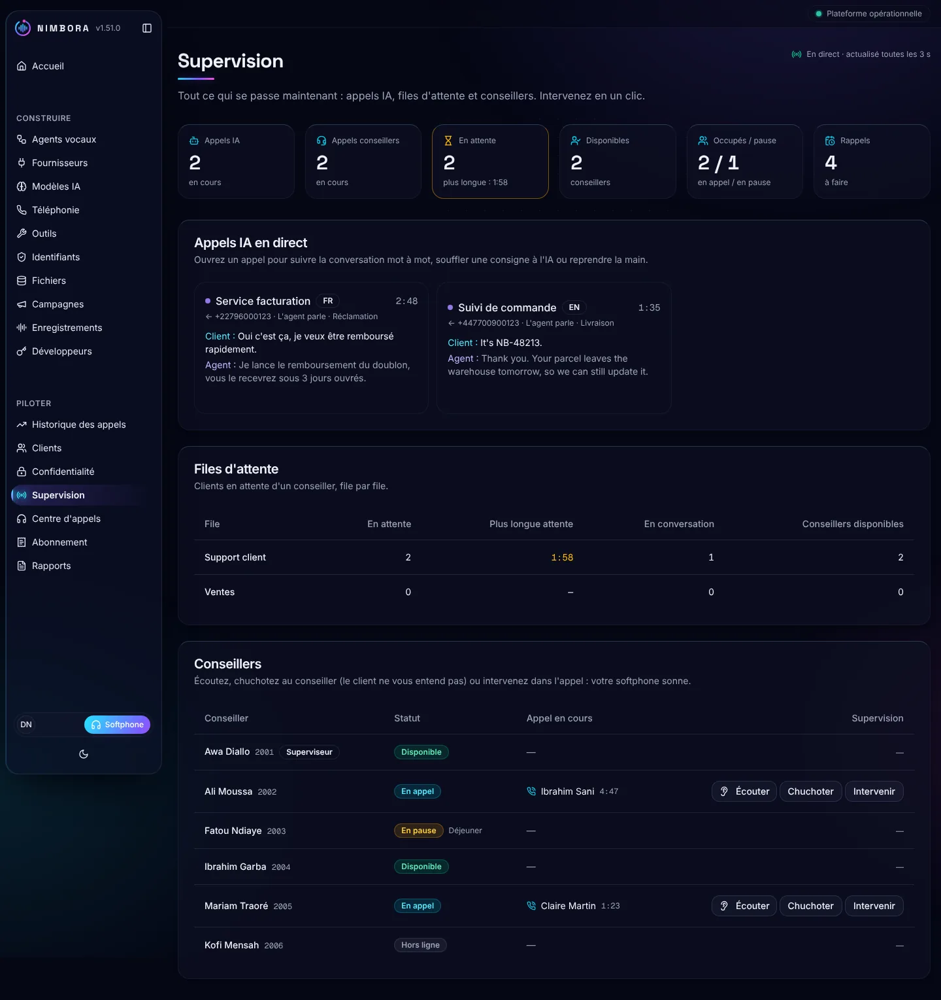
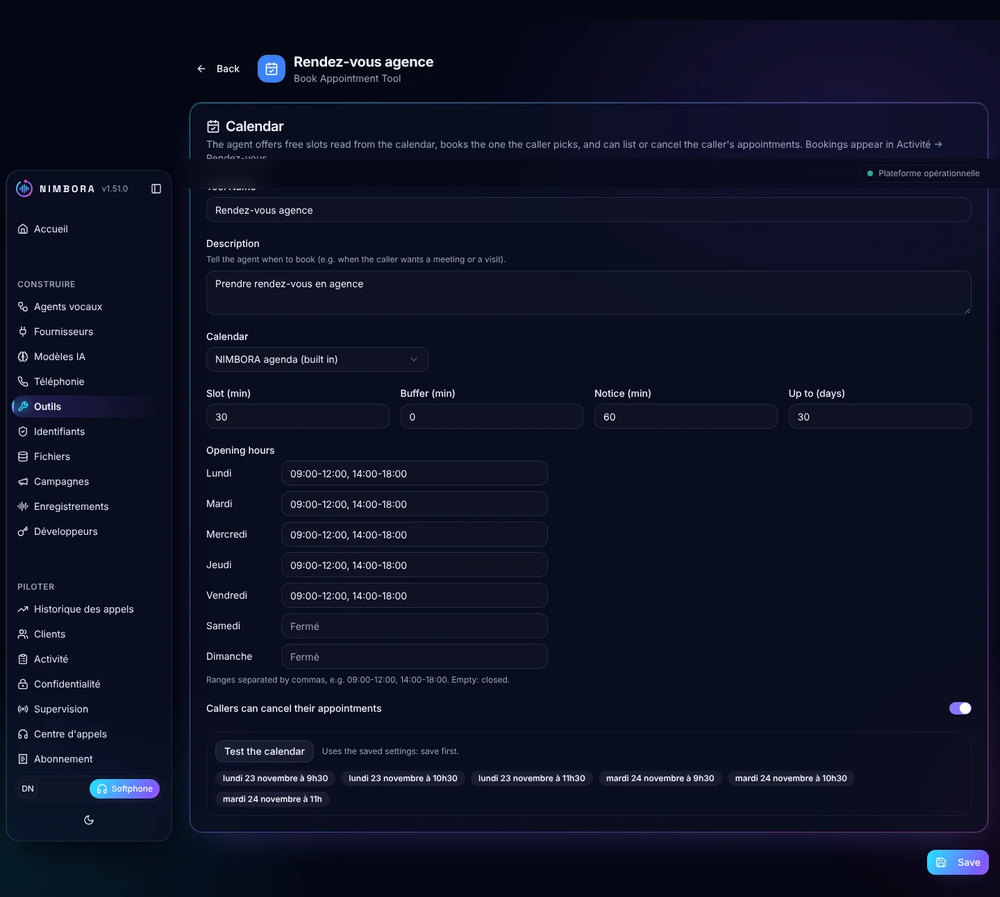
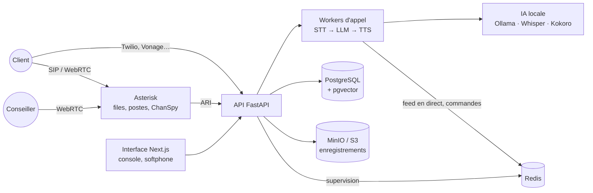

<p align="center">
  
</p>

<p align="center"><strong>Le centre d'appels qui pense, parle et décide.</strong></p>

<p align="center">
  Agents vocaux IA · centre d'appels humain · supervision en direct · IA souveraine · multi-entreprises
</p>

<p align="center">
  <a href="LICENSE"></a>
  
  
  
  
</p>

<p align="center">
  
</p>

NIMBORA est une plateforme de centre d'appels **100 % auto-hébergée** que vous proposez en
abonnement à des entreprises. Chaque entreprise cliente dispose de ses agents vocaux IA, de ses
files d'attente et de ses conseillers humains, sur **votre** serveur et avec **vos** modèles d'IA.
Les agents IA décrochent, comprennent, agissent avec des outils, se souviennent de chaque client,
passent la main à un humain avec un résumé, rappellent les clients perdus, et un superviseur peut
tout suivre et intervenir en direct.

---

## Ce qui rend NIMBORA différent

### 🎧 Supervision en direct

Tous les appels en cours sur un seul écran, sur tous les serveurs : appels IA, files d'attente,
conseillers. Suivez une conversation IA **mot à mot**, **soufflez une consigne** à l'IA sans que le
client l'entende, faites-lui dire une phrase, **reprenez la main** en transférant à un conseiller.
Côté humains : **écoute, chuchotement et intervention** dans l'appel d'un conseiller, en un clic.

<p align="center"></p>
<p align="center"></p>

### 🤝 Passation IA → humain avec contexte

Quand l'agent IA transfère vers une file, le conseiller qui décroche voit une **fiche de passation**
générée par l'IA : motif, résumé, prénom et humeur du client, prochaine étape, données collectées et
transcription. Plus besoin de faire répéter le client.

### 🧠 Mémoire client

Chaque appelant est reconnu à son numéro. L'agent reprend la conversation là où elle s'était
arrêtée (« Bonjour Awa, votre colis est-il bien arrivé ? »). Fiches clients, historique des
échanges, notes et étiquettes, effacement à la demande.

### ⚡ Des agents qui agissent : rendez-vous, messages, tickets

Pendant l'appel, l'agent ne se contente pas de répondre : il **fait**.

- **Prend rendez-vous** : il propose les créneaux réellement libres, réserve celui que le client
  choisit, retrouve ou annule ses rendez-vous. Agenda NIMBORA intégré, **CalDAV** (Nextcloud,
  iCloud, Zimbra, SOGo…) ou **Google Agenda**, avec horaires d'ouverture, délai de prévenance et
  protection contre les doubles réservations.
- **Envoie un SMS, un WhatsApp ou un e-mail** : adresse, lien de paiement, confirmation, numéro de
  suivi. Twilio, n'importe quelle passerelle SMS (HTTP) ou SMTP, avec modèles et limite par appel.
- **Ouvre un ticket** et donne son numéro au client, puis lui dit où en est sa demande lors des appels
  suivants. Helpdesk NIMBORA intégré, **Zendesk** ou **Freshdesk**.

Tout ce que les agents ont fait se retrouve dans la page **Activité**.

<p align="center"></p>
<p align="center"></p>

### 📅 Rappels automatiques : aucun client perdu

- L'agent IA **planifie un rappel** à l'heure choisie par le client (« demain 10 h »).
- Un client qui raccroche en file d'attente devient **automatiquement** un rappel pour l'équipe.
- Rappel par un **agent IA** à l'heure prévue (3 tentatives) ou par un **conseiller en un clic**.

<p align="center"></p>

### 🌍 Détection automatique de la langue

L'agent suit la langue du client : il répond dans la sienne **et change de voix** (Kokoro / Piper en
local, voix multilingues cloud). Un mot isolé ne fait jamais basculer la conversation. Chaque client
est accueilli dans la langue de son dernier appel. Français, anglais, espagnol, portugais, arabe,
swahili, haoussa, yoruba, lingala…

<p align="center"></p>

### 🔒 RGPD et PCI DSS intégrés

- **Masquage** des cartes bancaires (contrôle Luhn), IBAN, n° de sécurité sociale, cryptogrammes,
  e-mails (même dictés), téléphones et adresses IP dans tout ce qui est conservé.
- **Mode PCI** : l'agent IA n'entend jamais un numéro de carte, ni la supervision, ni les journaux.
- **Durées de conservation** des enregistrements, transcriptions et de la mémoire client, purge quotidienne.
- **Droit d'accès et droit à l'effacement** à partir d'un numéro, avec registre des demandes.

<p align="center"></p>

---

## Toutes les fonctionnalités

| | |
|---|---|
| **Agents vocaux IA** | Éditeur visuel de workflows, appels entrants et sortants, campagnes, outils HTTP / MCP / intégrations, base de connaissances, extraction de données, QA automatique |
| **Outils de l'agent** | Prise de rendez-vous (NIMBORA, CalDAV, Google Agenda), SMS / WhatsApp / e-mail, tickets (NIMBORA, Zendesk, Freshdesk), transfert vers un humain ou un autre agent, rappel, fin d'appel, calculatrice, appels d'API, serveurs MCP |
| **Activité** | Rendez-vous, messages envoyés et tickets ouverts par les agents, avec annulation, statut et résolution |
| **Centre d'appels humain** | Files d'attente Asterisk, postes avec softphone WebRTC dans le navigateur, pauses avec motif, fiches de passation, rappels en un clic |
| **Supervision** | Indicateurs en direct, suivi mot à mot des appels IA, consignes soufflées à l'IA, reprise en main, écoute / chuchotement / intervention |
| **Mémoire et clients** | Reconnaissance des appelants, historique, résumé et humeur de chaque appel, langue préférée |
| **Langues** | Détection automatique, voix par langue, packs de langues locaux |
| **IA souveraine** | LLM (Ollama, vLLM), Whisper (~100 langues), voix Kokoro / Piper, sans clé d'API ni donnée envoyée à l'extérieur. Fournisseurs cloud (OpenAI, Anthropic, Deepgram, ElevenLabs…) en option |
| **Confidentialité** | Masquage des données personnelles, mode PCI, journaux masqués, durées de conservation, export et effacement RGPD |
| **SaaS multi-entreprises** | Offres et abonnements, essai gratuit, quotas de minutes, limites par client, paiement Stripe optionnel, console opérateur |
| **Téléphonie** | Asterisk (SIP), Twilio, Vonage, Telnyx, Plivo, WhatsApp… |
| **Sécurité** | Isolation stricte entre entreprises, protection SSRF, secrets générés à l'installation, télémétrie désactivée |

## Architecture



| Dossier | Contenu |
|---|---|
| `api/` | Backend FastAPI (Python 3.13), PostgreSQL + pgvector, Redis / ARQ, MinIO |
| `api/services/supervision/` | Appels en direct (Redis), actions du superviseur, état Asterisk |
| `api/services/contact_center/` | Files, postes, passations, rappels, configuration Asterisk générée |
| `api/services/customer_memory/` | Mémoire client |
| `api/services/language/` | Détection de langue, voix par langue |
| `api/services/privacy/` | Masquage, conservation, export et effacement RGPD |
| `api/services/actions/` | Actions des agents : agenda (créneaux, CalDAV, Google), messages, tickets |
| `ui/` | Interface Next.js 15 / React 19, charte NIMBORA (`ui/scripts/brand/`) |
| `pipecat/` | Moteur de pipeline vocal (STT → LLM → TTS) |
| `deploy/enterprise/` | Déploiement Docker Compose : Caddy, Asterisk, coturn, Ollama, Speaches |
| `docs/` | Documentation Mintlify |
| `sdk/` | SDK Python et TypeScript |

## Installation sur un VPS

```bash
git clone https://github.com/optimiumnexusllc/nimbora.git /opt/nimbora
cd /opt/nimbora/deploy/enterprise
sudo ./install.sh --domain callcenter.mondomaine.com --email admin@mondomaine.com
```

Guide complet (serveur, GPU, Stripe, trunks SIP, sauvegardes) :
[`deploy/enterprise/README.md`](deploy/enterprise/README.md).

Principaux réglages de la plateforme :

| Variable | Rôle |
|---|---|
| `SAAS_MODE` | Abonnements, quotas et console opérateur multi-entreprises |
| `LOCAL_AI_ENABLED` | IA locale (Ollama, Speaches) et packs de langues |
| `CONTACT_CENTER_ENABLED` | Centre d'appels humain, supervision des conseillers |
| `ASTERISK_ARI_URL` / `ASTERISK_ARI_USER` / `ASTERISK_ARI_PASSWORD` | Accès à Asterisk |
| `PRIVACY_REDACT_LOGS` | Masquage des données personnelles dans les journaux (activé par défaut) |

## Documentation

- [Centre d'appels humain](docs/contact-center/overview.mdx) et [supervision en direct](docs/contact-center/supervision.mdx)
- [Planifier un rappel](docs/voice-agent/tools/schedule-callback.mdx)
- [Prendre rendez-vous](docs/voice-agent/tools/book-appointment.mdx), [envoyer un message](docs/voice-agent/tools/send-message.mdx), [ouvrir un ticket](docs/voice-agent/tools/create-ticket.mdx)
- [Détection automatique de la langue](docs/voice-agent/languages.mdx)
- [Confidentialité, RGPD et PCI](docs/configurations/privacy.mdx)
- [Référence de l'API](docs/api-reference/openapi.json)

## Feuille de route

| Statut | Fonctionnalité |
|---|---|
| ✅ | Passation IA → humain avec fiche de contexte |
| ✅ | Mémoire client |
| ✅ | Rappels automatiques |
| ✅ | Détection automatique de la langue |
| ✅ | Masquage des données personnelles et RGPD |
| ✅ | Console de supervision en direct |
| ✅ | Actions prêtes à l'emploi : agenda (CalDAV, Google), SMS / WhatsApp / e-mail, tickets |
| 🔜 | Routage intelligent (compétences, langue, client VIP, conseiller habituel) |
| 🔜 | Contrôle qualité des appels humains |
| 🔜 | Tableau de bord des tendances (motifs d'appel, sentiment, résolution) |
| 🔜 | Tests des agents avec des clients simulés |

## Développement

Voir [`docs/contribution/setup.mdx`](docs/contribution/setup.mdx).

```bash
# Tests backend
source venv/bin/activate && set -a && source api/.env.test && set +a && python -m pytest api/tests
# Interface
cd ui && npm install && npm run dev
```

## Licence

Distribué sous licence BSD 2-Clause (voir [`LICENSE`](LICENSE) et [`NOTICE.md`](NOTICE.md)).
