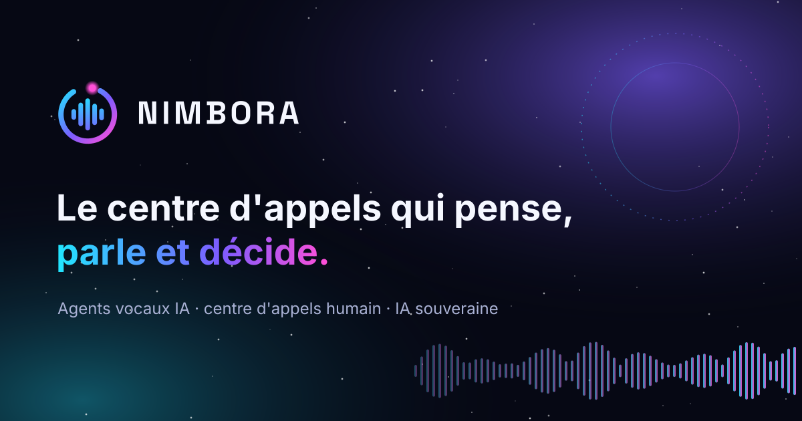

<p align="center">
  
</p>

<p align="center"><strong>Le centre d'appels qui pense, parle et décide.</strong></p>

<p align="center">
  Agents vocaux IA · centre d'appels humain · IA souveraine · multi-entreprises
</p>

<p align="center">
  
</p>

NIMBORA est une plateforme de centre d'appels **100 % auto-hébergée** que vous proposez
en abonnement à des entreprises. Chaque entreprise cliente dispose de ses agents vocaux IA,
de ses files d'attente et de ses agents humains, sur **votre** serveur et avec vos modèles d'IA.

## Fonctionnalités

| | |
|---|---|
| **Agents vocaux IA** | Éditeur visuel de workflows, appels entrants et sortants, campagnes, outils HTTP, base de connaissances, transfert vers un humain |
| **IA souveraine** | LLM (Ollama, vLLM), reconnaissance vocale Whisper (~100 langues) et voix Kokoro / Piper, sans aucune clé d'API ni donnée envoyée à l'extérieur. Fournisseurs cloud (OpenAI, Deepgram, ElevenLabs…) en option |
| **Centre d'appels humain** | Files d'attente Asterisk, postes d'agents, softphone WebRTC dans le navigateur, transfert IA → humain (`queue:support`) |
| **SaaS multi-entreprises** | Offres et abonnements, essai gratuit, quotas de minutes, limites par client, paiement Stripe optionnel, console opérateur |
| **Téléphonie** | Asterisk (SIP), Twilio, Vonage, Telnyx, Plivo, WhatsApp… |
| **Sécurité** | Isolation stricte entre entreprises, protection SSRF, secrets générés à l'installation, télémétrie désactivée |

## Installation sur un VPS

```bash
git clone https://github.com/optimiumnexusllc/nimbora.git /opt/nimbora
cd /opt/nimbora/deploy/enterprise
sudo ./install.sh --domain callcenter.mondomaine.com --email admin@mondomaine.com
```

Guide complet (serveur, GPU, Stripe, trunks SIP, sauvegardes) :
[`deploy/enterprise/README.md`](deploy/enterprise/README.md).

## Architecture

| Dossier | Contenu |
|---|---|
| `api/` | Backend FastAPI (Python 3.13), PostgreSQL + pgvector, Redis, MinIO |
| `ui/` | Interface Next.js 15 / React 19, charte NIMBORA (`ui/scripts/brand/`) |
| `pipecat/` | Moteur de pipeline vocal (STT → LLM → TTS) |
| `deploy/enterprise/` | Déploiement Docker Compose : Caddy, Asterisk, coturn, Ollama, Speaches |
| `docs/` | Documentation |
| `sdk/` | SDK Python et TypeScript |

## Développement

Voir [`docs/contribution/setup.mdx`](docs/contribution/setup.mdx).

```bash
# Tests backend
source venv/bin/activate && set -a && source api/.env.test && set +a && python -m pytest api/tests
# Interface
cd ui && npm install && npm run dev
```

## Licence

Distribué sous licence BSD 2-Clause (voir [`LICENSE`](LICENSE) et [`NOTICE.md`](NOTICE.md)).
